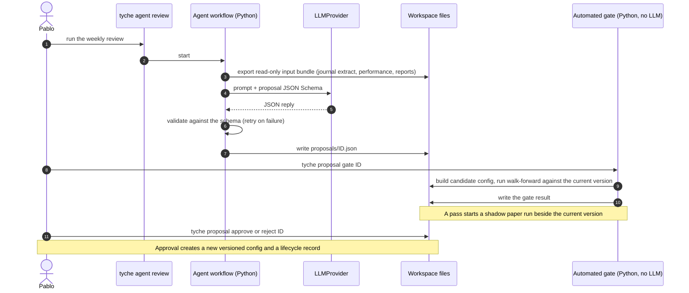

# Agent architecture

*Status: Phase 0 design, accepted by Pablo on 2026-11-16. Agents are built in Phase 3; this page fixes the shape now so that nothing built before then gets in the way.*

Learning agent architecture is goal #1 of this project, so this page explains the reasoning as well as the design. The decision record is [ADR-0007](../adr/0007-python-driven-agents.md).

## 1. The core idea

An agent in Tyche is **a Python workflow with one LLM call in the middle**:

```text
gather inputs  →  build prompt  →  call the LLM  →  validate the reply  →  write a file
   (code)           (code)        (LLMProvider)        (code)              (code)
```

Python owns the workflow. The LLM is a function that takes text and a JSON Schema and returns JSON. Everything before and after the call is ordinary, testable code.

This was a choice. The alternative is to let Claude Code be the agent: give it a prompt and tools and let it explore. That is more flexible, but the workflow then lives inside a prompt, cannot be unit-tested, and cannot be moved to a local model. You chose the Python-driven design on 2026-11-16.

## 2. Why LLMs stay out of the trading path

| Reason | What goes wrong otherwise |
|---|---|
| Determinism | The same inputs must give the same orders, or a backtest proves nothing. LLM output varies between calls and between model versions. |
| Testability | The risk layer is property-tested against every input. An LLM cannot be tested that way. |
| Accountability | Every order must trace back to a rule and its inputs. "The model felt bullish" is not a reason you can audit or backtest. |
| Injection | A research agent reads text written by other people. If that text could influence an order, anyone who can publish text can move your money. |
| Availability and cost | The trading path must run unattended at $0 and without a network call to a model provider. |

So agents produce **proposals and notes**, which are data. Code and you decide what happens to them.

## 3. The agents

Three agents, each with one job.

| Agent | You run | It reads | It writes |
|---|---|---|---|
| **Research analyst** | `tyche agent research` | Universe snapshot, screening ranks, price and volume summaries | A research note in `research/` |
| **Performance reviewer** | `tyche agent review` (wrapped by `/weekly-review`) | Journal extract, performance versus the benchmark, risk events, recent backtest reports, earlier proposals and how they turned out | Proposals in `proposals/` |
| **Strategy proposer** | `tyche agent propose-strategy` | Research notes, the strategy interface documentation, existing strategies and their results | A draft strategy file and config, plus a proposal |

The Claude Code slash commands in `.claude/commands/` are thin wrappers: they run the `tyche` command, then help you read and discuss the result. The logic is in Python.

## 4. Contracts

Every agent input and output is a file with a JSON Schema, validated when written and again when read.

| File | Purpose | Main fields |
|---|---|---|
| Input bundle | Everything the agent is allowed to see, exported read-only for one run | `agent`, `as_of`, `data` (agent-specific), `bundle_hash` |
| Research note | Observations about instruments or the universe | `as_of`, `subjects`, `observations`, `sources`, `confidence` |
| Proposal | One suggested change | `id`, `kind` (parameter change, new filter, retire strategy, new strategy, risk-profile change), `target`, `change`, `evidence`, `expected_effect`, `risks`, `bundle_hash` |
| Gate result | What the automated gate found | `proposal_id`, `candidate_config_hash`, `walk_forward` (in-sample and out-of-sample versus the current version), `trial_number`, `verdict` |
| Decision | Your approval or rejection | `proposal_id`, `decision`, `decided_by`, `decided_at`, `note` |

Schemas reject unknown fields. A reply that does not validate is retried a small, fixed number of times with the validation error included, then recorded as a failed run.

## 5. Data flow



The loop has four gates, in order: schema validation, the walk-forward gate, the shadow paper run, and your approval. An LLM is involved only before the first one.

## 6. The `LLMProvider` port

A sketch of the interface (final signatures in Phase 3):

```python
class LLMProvider(Protocol):
    def complete(self, request: LLMRequest) -> LLMResponse: ...


# LLMRequest:  system prompt, user prompt, JSON Schema for the reply, limits
# LLMResponse: parsed JSON, raw text, provider name, model name, token and time usage
```

| Adapter | How it works | Cost | Phase |
|---|---|---|---|
| `claude-code` (default) | Runs headless `claude -p` as a subprocess with tools disabled | Uses your existing plan | 3 |
| `ollama` | HTTP call to a local model | Free, local | Later |
| `anthropic-api` | Direct API call | Paid per token; will be flagged before enabling | Later |

Which adapter each agent uses is a config value, so one agent can move to a local model while the others stay on Claude. The exact `claude -p` flags and their behaviour will be checked against the current Claude Code documentation in Phase 3.

## 7. Boundaries

What stops an agent, or a bug in an agent, from affecting trading:

| Boundary | How it is enforced |
|---|---|
| **Code** | `tyche.core.pipeline`, `risk`, `engine`, `sim` and `tyche.strategies` cannot import `tyche.core.agents` or `tyche.adapters.llm`. An import-linter contract fails CI otherwise. |
| **Inputs** | The agent sees only its exported bundle. The LLM subprocess is started without broker or Discord secrets in its environment and without tools. |
| **Outputs** | The reply is data, validated against a schema, written only under `research/` or `proposals/`. |
| **Authority** | A proposal never applies itself. Applying one is a CLI command you run. Changing the live risk profile or the guardrails is a separate manual command, and agents may only *propose* profile changes. |
| **Generated code** | A draft strategy written by the strategy proposer is untrusted code. Tyche will not execute it, even in a backtest, until you have marked it as reviewed. |

## 8. Keeping the loop honest

A loop that proposes a change every week and tests it on the same history will eventually pass something by luck. Four rules guard against that:

1. **Trial registry.** Every candidate ever evaluated for a strategy is recorded. Gate results show the trial number, and the pass threshold tightens as trials accumulate.
2. **Holdout.** The most recent slice of history is reserved, starting with the first backtest in Phase 1 so that nothing has seen it before the loop exists: from 2024-01-01, a fixed date in the workspace ([ADR-0024](../adr/0024-backtest-runner-holdout-and-run-record.md)). The reviewer's input bundle and the walk-forward never include it; it is used once, for the final check before promotion.
3. **Pre-registered effect.** A proposal must state its expected effect before the gate runs. The gate reports the actual effect beside it, so a proposal that "worked" for a different reason than claimed is visible.
4. **Deflated results.** Gate results report a deflated Sharpe ratio, or an equivalent correction, that discounts performance for the number of trials behind it. A raw Sharpe ratio from the best of many attempts is not shown alone.

## 9. Where this lives in the code

| Concern | Location |
|---|---|
| Agent workflows, prompts, input bundles | `tyche.core.agents` |
| Proposal schema, gate, trial registry, approval, strategy lifecycle | `tyche.core.improvement` |
| `LLMProvider` port | `tyche.core.ports` |
| LLM adapters | `tyche.adapters.llm` |
| Slash-command wrappers | `.claude/commands/` |

The plain-language version of this page is the learning note [The gated agent loop](../learning/gated-agent-loop.md).
