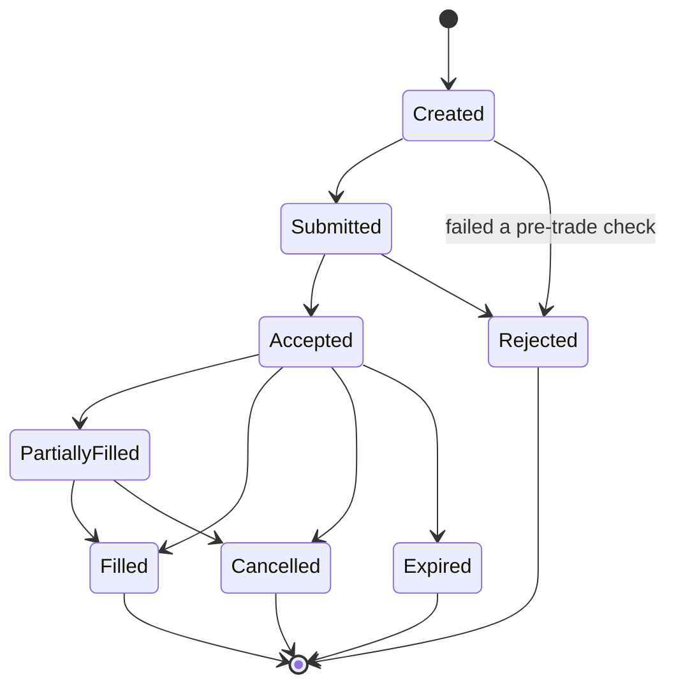

# Event catalog

*Status: Phase 0 design, accepted by Pablo on 2026-11-16. Field lists show the important fields, not final signatures; those are fixed when each event is implemented and this page is updated in the same PR. Implemented so far: the envelope and the bus. Each event in the catalog is added by the PR that first publishes it.*

Every component in the trading path communicates through the events on this page. The bus and its ordering rules are described in [ADR-0003](../adr/0003-synchronous-event-bus.md).

## Conventions

- **Events are immutable facts.** An event says something happened ("this bar closed", "this order was filled"). It is never edited after it is published.
- **Names end in `Event`** and are in the past or present tense of a fact, not a command.
- **All timestamps are timezone-aware UTC** ([ADR-0012](../adr/0012-money-and-time-types.md)). A bar's timestamp is the moment the bar became known (its close), which is what makes lookahead visible in code.
- **Events carry domain objects** (`Instrument`, `Money`, `Order`), never dataframes or vendor objects.

## The envelope

An event holds only its own facts: which bar, which order. The bus wraps every published event in an `Envelope` and fills in the delivery details, so the component that creates an event cannot get them wrong. Handlers receive the envelope and read the event from `envelope.event`.

| Field | Set by | Meaning |
|---|---|---|
| `seq` | The bus | Position in the run's event sequence, starting at 1. Events are handled in this order, and two runs of the same backtest can be compared event by event. |
| `occurred_at` | The bus, from the clock | Time when the event was published, in UTC. Simulated time in a backtest. |
| `source` | The publisher | Name of the component that published it. Inside a handler it defaults to that subscriber's name. |
| `caused_by` | The bus | `seq` of the event whose handler published this one. Empty for an input from outside, such as a bar from the feed. Following these links answers "why did this order exist?". |
| `cycle_id` | Whoever starts a cycle | The decision cycle this event belongs to, if any. Everything published while handling an event inherits that event's cycle. Fills and stop triggers that arrive between cycles have none. |
| `event` | The publisher | The event itself. |

Causation is automatic. A handler calls `bus.publish(SomeEvent(...))` and nothing else; the bus knows which event is being handled and records it as the cause.

## Rules the bus enforces

From [ADR-0003](../adr/0003-synchronous-event-bus.md), implemented in `tyche.core.events.bus`:

| Rule | What happens otherwise |
|---|---|
| An event class is a frozen dataclass whose name ends in `Event` | `TypeError` when the class is defined (name) or first published (not frozen) |
| `publish` only queues; `drain` delivers until the queue is empty | Calling `drain` from inside a handler is an error |
| Subscribers run in registration order, and a subscription covers subclasses | Subscribing to `Event` receives everything; this is how the journal works |
| Subscriptions close at the first publish | A late `subscribe` raises, so no subscriber can miss the start of a run |
| An input from outside must name its source | `publish` raises |
| A handler that raises halts the bus for good | `HandlerError`; nothing still queued is delivered |
| One drain may not exceed a set number of events | `RunawayDispatchError` and a halt; this catches handlers publishing to each other in a loop |

## Two patterns used below

**Batch marker.** When a stage must wait for a group of events (all bars for a timestamp, all strategies' signals), the publisher sends the items and then one `...ReadyEvent`. Consumers act on the marker, not on a count or a timer. This is what lets daily and intraday bars share one code path.

**Proposed versus approved.** Portfolio construction publishes a *proposed* target. The risk gate is the only component that can publish an *approved* one, and execution subscribes only to the approved type. The types make the bypass impossible.

## Catalog

### Market data and time

| Event | Published by | Consumed by | Key fields | Phase |
|---|---|---|---|---|
| `SessionEvent` | Engine (from `Clock` and `Calendar`) | Broker, risk, scheduler | `calendar`, `session_date`, `kind` (open or close), `is_half_day` | 1 |
| `BarEvent` | Data feed | Broker (to fill waiting orders and check stops), market-data store | `instrument`, `timeframe`, `open`, `high`, `low`, `close`, `volume`, `is_adjusted` | 1 |
| `DataReadyEvent` | Data feed | Universe (starts a decision cycle) | `timeframe`, `as_of`, `instruments`, `missing` | 1 |
| `DataQualityEvent` | Data feed (from each `DataIssue` in a `BarHistory`) | Journal, notifier, universe | `instrument`, `kind` (the `DataIssueKind`: missing session, off session, duplicate, conflict, wrong series, mixed adjustment, suspect move; plus fetch failed), `session_day`, `detail` | 1 (PR 7) |

### Decision cycle (pipeline stages 1 to 5)

| Event | Published by | Consumed by | Key fields | Phase |
|---|---|---|---|---|
| `UniverseEvent` | Universe | Screening | `as_of`, `eligible`, `excluded` (each with a reason) | 1 |
| `ScreeningEvent` | Screening | Signals | `as_of`, `ranked` (instrument, score, screen name) | 1 |
| `SignalEvent` | Signals (one per strategy) | Portfolio construction | `strategy_id`, `strategy_version`, `as_of`, `targets` (instrument, weight within the strategy's budget, optional `stop_price`, `reason`) | 1 |
| `SignalsReadyEvent` | Signals | Portfolio construction | `strategies` reported, `failed` (strategy and error) | 1 |
| `TargetPortfolioEvent` | Portfolio construction | Risk gate only | `as_of`, `targets` (instrument, quantity, optional `stop_price`, contribution per strategy), `conflicts_resolved` | 1 |
| `RiskEvent` | Risk gate | Journal, notifier | `rule`, `scope` (order, position, strategy, account), `action` (shrink, block, flatten, halt), `before`, `after`, `profile` | 2 |
| `ApprovedPortfolioEvent` | Risk gate only | Execution | `as_of`, `targets`, `profile`, `adjustments` (the `RiskEvent`s applied) | 1 (pass-through gate), 2 (real rules) |

### Orders, fills and account state (stages 6 and 7)

| Event | Published by | Consumed by | Key fields | Phase |
|---|---|---|---|---|
| `OrderEvent` | Execution (created, submitted), broker (every later status) | Broker, account state, journal | `order_id`, `client_order_id` (idempotency key), `instrument`, `side`, `quantity`, `order_type` (market, stop), `time_in_force`, `status`, `reason` | 1 |
| `FillEvent` | Broker | Account state, journal | `order_id`, `quantity`, `price`, `commission`, `currency`, `fx_rate_to_cad` | 1 |
| `AccountEvent` | Account state | Risk, reconciliation, journal | `cash` per currency (settled and unsettled), `positions`, `equity`, `peak_equity` | 1 |
| `DistributionEvent` | Data feed (from the `CashDistribution`s in a `BarHistory`) | Broker (credits cash to holders), journal | `instrument`, `ex_date`, `amount_per_share`, `kind` (dividend or capital gain) | 1 (PR 10) |
| `FxConversionEvent` | Broker | Account state, journal | `from`, `to`, `amount`, `rate`, `cost` | 4 |
| `ReconciliationEvent` | Reconciliation | Engine (halts on mismatch), journal, notifier | `status` (match or mismatch), `differences` | 2 |

`OrderEvent.status` follows one lifecycle. One event is published per transition:

The `client_order_id` is derived from the decision that created the order (cycle, instrument, side, purpose), so sending the same decision twice produces the same id and the broker adapter can drop the duplicate.

### System

| Event | Published by | Consumed by | Key fields | Phase |
|---|---|---|---|---|
| `RunEvent` | Engine, scheduler | Journal, notifier | `run_id`, `mode`, `kind` (started, completed, failed, skipped), `reason`, `config_hash`, `code_version` | 1 |
| `HaltEvent` | Risk (drawdown), reconciliation, kill switch | Engine, execution, notifier | `cause`, `flatten`, `resume_requires` (always a manual step) | 2 |

## What is deliberately not an event

- **Agent activity.** Research notes and proposals are files in the workspace, not events. Agents run offline and have no access to the bus.
- **Notifications.** The notifier subscribes to the events above and formats messages. There is no `NotificationEvent`, so nothing can ask the notifier to say something that did not happen.
- **Configuration changes.** Config is loaded and validated once at startup. Changing the risk profile or a strategy's state is a CLI command that writes to the database and takes effect on the next run; it is recorded in the journal as an audit entry.
