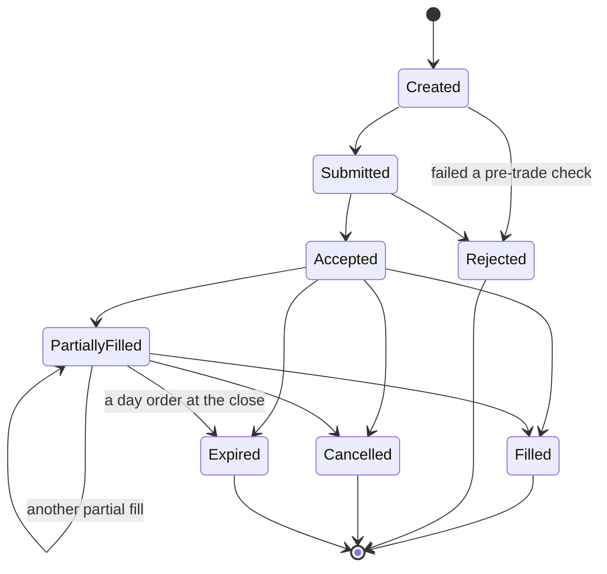

# Event catalog

*Status: Phase 0 design, accepted by Pablo on 2026-11-16. Field lists show the important fields, not final signatures; those are fixed when each event is implemented and this page is updated in the same PR. Implemented so far: the envelope, the bus, `SessionEvent`, `BarEvent`, `DataReadyEvent`, `DataQualityEvent`, `RunEvent`, `UniverseEvent`, `ScreeningEvent`, `SignalEvent`, `SignalsReadyEvent`, `TargetPortfolioEvent`, `ApprovedPortfolioEvent`, `ExecutionPlanEvent`, `OrderEvent`, `CancelRequestEvent`, `FillEvent`, `AccountEvent` and `DistributionEvent` (marked **implemented** below). Each other event is added by the PR that first publishes it.*

Every component in the trading path communicates through the events on this page. The bus and its ordering rules are described in [ADR-0003](../adr/0003-synchronous-event-bus.md).

## Conventions

- **Events are immutable facts.** An event says something happened ("this bar closed", "this order was filled"). It is never edited after it is published.
- **Names end in `Event`** and are in the past or present tense of a fact, not a command.
- **All timestamps are timezone-aware UTC** ([ADR-0012](../adr/0012-money-and-time-types.md)). A bar's timestamp is the moment the bar became known (its close), which is what makes lookahead visible in code.
- **Events carry domain objects** (`Instrument`, `Money`, `Order`), never dataframes or vendor objects.

## The envelope

An event holds only its own facts: which bar, which order. The bus wraps every published event in an `Envelope` and fills in the delivery details, so the component that creates an event cannot get them wrong. Handlers receive the envelope and read the event from `envelope.event`.

| Field | Set by | Meaning |
|---|---|---|
| `seq` | The bus | Position in the run's event sequence, starting at 1. Events are handled in this order, and two runs of the same backtest can be compared event by event. |
| `occurred_at` | The bus, from the clock | Time when the event was published, in UTC. Simulated time in a backtest. |
| `source` | The publisher | Name of the component that published it. Inside a handler it defaults to that subscriber's name. |
| `caused_by` | The bus | `seq` of the event whose handler published this one. Empty for an input from outside, such as a bar from the feed. Following these links answers "why did this order exist?". |
| `cycle_id` | Whoever starts a cycle | The decision cycle this event belongs to, if any. Everything published while handling an event inherits that event's cycle. Fills and stop triggers that arrive between cycles have none. |
| `event` | The publisher | The event itself. |

Causation is automatic. A handler calls `bus.publish(SomeEvent(...))` and nothing else; the bus knows which event is being handled and records it as the cause.

## Rules the bus enforces

From [ADR-0003](../adr/0003-synchronous-event-bus.md), implemented in `tyche.core.events.bus`:

| Rule | What happens otherwise |
|---|---|
| An event class is a frozen dataclass whose name ends in `Event` | `TypeError` when the class is defined (name) or first published (not frozen) |
| `publish` only queues; `drain` delivers until the queue is empty | Calling `drain` from inside a handler is an error |
| Subscribers run in registration order, and a subscription covers subclasses | Subscribing to `Event` receives everything; this is how the journal works |
| Subscriptions close at the first publish | A late `subscribe` raises, so no subscriber can miss the start of a run |
| An input from outside must name its source | `publish` raises |
| A handler that raises halts the bus for good | `HandlerError`; nothing still queued is delivered |
| One drain may not exceed a set number of events | `RunawayDispatchError` and a halt; this catches handlers publishing to each other in a loop |

## Two patterns used below

**Batch marker.** When a stage must wait for a group of events (all bars for a timestamp, all strategies' signals), the publisher sends the items and then one `...ReadyEvent`. Consumers act on the marker, not on a count or a timer. This is what lets daily and intraday bars share one code path.

**Proposed versus approved.** Portfolio construction publishes a *proposed* target. The risk gate is the only component that can publish an *approved* one, and execution subscribes only to the approved type. The types make the bypass impossible.

## Catalog

### Market data and time

Within one moment, the feed's inputs come in a fixed order: session open, then any `DistributionEvent` going ex (at the open), then each instrument's `BarEvent`, then any `DataQualityEvent` for the day, then session close, then `DataReadyEvent`. The bus finishes everything each input causes before the next one (ADR-0003), so a decision cycle always sees every bar and every fill from that moment.

| Event | Published by | Consumed by | Key fields | Phase |
|---|---|---|---|---|
| `SessionEvent` | Feed (in a backtest, `HistoricalReplay` from the `Calendar`) | Broker, risk, scheduler | `session` (calendar, day, open and close times, half day), `phase` (open or close) | **implemented** (PR 7) |
| `BarEvent` | Feed, at the bar's own timestamp | Broker (to fill waiting orders and check stops), universe (keeps the last few bars), market-data store | `bar` (instrument, timeframe, timestamp, prices, volume, `adjustment`) | **implemented** (PR 7) |
| `DataReadyEvent` | Feed, after every bar for the decision time | Universe (starts a decision cycle: publishes one `UniverseEvent`) | `timeframe`, `as_of`, `delivered`, `missing` | **implemented** (PR 7) |
| `DataQualityEvent` | Feed (from each `DataIssue` in a `BarHistory`: at its session's close, or before the first session if it has none) | Journal, notifier, universe (excludes the instrument for a few cycles after a disqualifying issue) | `issue` (instrument, `DataIssueKind`, session day, detail) | **implemented** (PR 7) |

### Decision cycle (pipeline stages 1 to 5)

| Event | Published by | Consumed by | Key fields | Phase |
|---|---|---|---|---|
| `UniverseEvent` | Universe, once per `DataReadyEvent` | Screening, journal | `as_of`; `eligible`: `UniverseMember`s (instrument, `last_close`, `average_dollar_volume`); `excluded`: `Exclusion`s (instrument, `ExclusionReason`, `detail`). Every instrument the feed expected appears exactly once. The reasons, in the order they are checked: `not_in_profile`, `no_bar`, `data_issue`, `insufficient_history`, `price_too_low`, `illiquid` | **implemented** (PR 11) |
| `ScreeningEvent` | Screening, once per `UniverseEvent` | Signals, journal | `as_of`, `screen` (its name), `ranked`: `ScoredInstrument`s (instrument, `score`), best first, ties broken by symbol; `cut`: eligible instruments below the screen's limit | **implemented** (PR 11) |
| `SignalEvent` | Signals, one per strategy that decided within the rules, once per `ScreeningEvent` | Portfolio construction, journal | `as_of`, `strategy_id`, `strategy_version`, `offered` (the instruments it was offered and so decided on; added in PR 13), `targets`: `Target`s (instrument, `weight` as a `Decimal` from 0 to 1 within the strategy's budget, `reason`, optional `stop_price` below the last close), adding up to at most 1; `warming_up`: ranked instruments not offered because the strategy lacks a full window (instrument, `bars_held`, `bars_needed`). An instrument offered and not targeted means zero; one held but not offered keeps its position ([ADR-0021](../adr/0021-strategies-see-a-window-handed-in.md)) | **implemented** (PR 12) |
| `SignalsReadyEvent` | Signals, after the cycle's `SignalEvent`s | Portfolio construction, journal | `as_of`, `reported` (strategy ids, in the order asked), `failed`: `StrategyFailure`s (strategy id, the exception or broken rule). A failing strategy publishes nothing that cycle; the run goes on | **implemented** (PR 12) |
| `TargetPortfolioEvent` | Portfolio construction, once per `SignalsReadyEvent` | Risk gate only | Weights of account equity, not shares ([ADR-0022](../adr/0022-portfolio-targets-as-weights-in-sleeves.md)). `as_of`; `sleeves`: one `Sleeve` per strategy (`budget`, `status` decided or failed, `decided_on`, `strategy_version`, `error`), by id; `targets`: one `InstrumentTarget` per instrument (its `contributions`, each a strategy's `budget × weight` with its own `reason` and optional `stop_price`), by symbol. Per sleeve and instrument: a contribution gives the weight, `decided_on` without one gives zero, anything else the sleeve holds is kept. No `conflicts_resolved`: long-only fractions of separate budgets only add | **implemented** (PR 13) |
| `RiskEvent` | Risk gate, one per cut, before the `ApprovedPortfolioEvent`; execution, one per purchase cut to the money caps, before the `ExecutionPlanEvent` | Journal, notifier | `as_of`, `profile` (the active risk profile), `adjustment`: a `RiskAdjustment` from the gate (`rule` risk_per_trade, max_position_size or max_open_positions; `scope` strategy or account; `action` shrink or block; `strategy_id`, `instrument`, `before` and `after` weights of equity, `limit`, `reason`) ([ADR-0033](../adr/0033-risk-gate-position-rules.md)), or an `OrderAdjustment` from execution (`rule` max_order_value or max_total_capital; `scope` order; `action` shrink or block; `instrument`, `before` and `after` in shares, `limit` the cap, `reason`) ([ADR-0034](../adr/0034-order-level-guardrails.md)). Actions `flatten` and `halt` arrive with PRs 4 and 8 | **implemented** (Phase 2, PRs 2 and 3); 2 (account rules) |
| `ApprovedPortfolioEvent` | Risk gate only (`RiskGate`) | Execution | `as_of`, `sleeves` and `targets` with the shape and reading rules of the `TargetPortfolioEvent` (`wanted(strategy, instrument)` gives a contribution, `None` for zero, or `KEEP`); `profile`, the active risk profile's name; `adjustments`, every `RiskAdjustment` made, in order, each also published as a `RiskEvent`. The gate only lowers or removes contributions, and the event checks that each adjusted contribution ends at its last adjustment's `after` ([ADR-0033](../adr/0033-risk-gate-position-rules.md)) | **implemented** (PR 14, pass-through; Phase 2, PR 2, position rules) |

### Orders, fills and account state (stages 6 and 7)

| Event | Published by | Consumed by | Key fields | Phase |
|---|---|---|---|---|
| `ExecutionPlanEvent` | Execution, once per `ApprovedPortfolioEvent`, before its orders | Journal, reports | `as_of`; `lines`: one `PlanLine` per sleeve and instrument it holds or targets (`held`, `target` in shares after the band, `crossed` from or to other sleeves, `ordered`, and a `note`: `keep`, `within_band`, `below_one_share`, `cash_limited` or `capped`), by strategy id then symbol ([ADR-0023](../adr/0023-execution-sleeves-stops-and-cash.md)); `sized_on`: the equity weights were sized on, one per currency, the account's or the guardrails' capital cap if lower ([ADR-0034](../adr/0034-order-level-guardrails.md)) | **implemented** (PR 14) |
| `OrderEvent` | Execution (submitted), broker (every later status) | Broker, execution, journal | The `OrderState`: the `Order` (`client_order_id` as idempotency key, `instrument`, `side`, `quantity`, `order_type` market or stop, `stop_price`, `time_in_force` day or GTC, `reason`), its `status`, `filled_quantity` and `note` (the reason for a rejection, cancellation or expiry). Domain types built in PR 8. `SimBroker` ignores a repeated `client_order_id` | **implemented** (PR 10) |
| `CancelRequestEvent` | Execution | Broker, journal | `client_order_id`, `reason`. A request, not a result: the broker publishes the `CANCELLED` status if the order was still open, and ignores the request if it had finished | **implemented** (PR 14) |
| `FillEvent` | Broker, just before the order's new status | Execution (splits it between sleeves), account state, journal | The `Fill`: `fill_id`, `client_order_id`, `instrument`, `side`, `quantity`, `price`, `commission` (commission plus regulatory fees, ADR-0020), `filled_at`, `trade_date`, `settles_on`. No `cycle_id`: fills arrive between cycles. The CAD exchange rate for tax is added in Phase 4 | **implemented** (PR 10) |
| `AccountEvent` | Account state (`AccountState`), at every session close, before that close's decision cycle | Execution (sizes from it), risk (Phase 2), reconciliation (Phase 2), journal | `as_of` (the close), `account`: a snapshot of the `Account` (cash per currency, settled and unsettled; positions at average cost; closing marks; realised profit; distributions). Peak equity is the risk layer's to track (Phase 2) | **implemented** (PR 14) |
| `DistributionEvent` | Data feed (from the `CashDistribution`s in a `BarHistory`), at the open of the ex-date session | Broker (credits cash to holders at the previous close), journal | `distribution`: a `CashDistribution` (`instrument`, `ex_date`, `amount_per_share`, `kind`) | **implemented** (PR 10) |
| `FxConversionEvent` | Broker | Account state, journal | `from`, `to`, `amount`, `rate`, `cost` | 4 |
| `ReconciliationEvent` | Reconciliation | Engine (halts on mismatch), journal, notifier | `status` (match or mismatch), `differences` | 2 |

`OrderEvent.status` follows one lifecycle. One event is published per transition:

The `client_order_id` is derived from the decision that created the order: `<decision time>-<symbol>.<exchange>-<side>` for a market order, `...-stop-<strategy>` for a stop placed at a decision, and `<fill id>-stop-<strategy>` for a stop placed when an entry fills. Sending the same decision twice produces the same ids, so the broker adapter can drop the duplicates, and execution ignores a decision it has already handled.

### System

| Event | Published by | Consumed by | Key fields | Phase |
|---|---|---|---|---|
| `RunEvent` | Engine, scheduler | Journal, notifier | `run_id`, `mode`, `stage` (started or completed), `code_version`, `config_hash`. A failed run cannot publish (the bus has halted), so the engine reports failure in its `RunResult`; a skipped run comes with the scheduler (Phase 2) | **implemented** (PR 7) |
| `HaltEvent` | Risk (drawdown), reconciliation, kill switch | Engine, execution, notifier | `cause`, `flatten`, `resume_requires` (always a manual step) | 2 |

## What is deliberately not an event

- **Agent activity.** Research notes and proposals are files in the workspace, not events. Agents run offline and have no access to the bus.
- **Notifications.** The notifier subscribes to the events above and formats messages. There is no `NotificationEvent`, so nothing can ask the notifier to say something that did not happen.
- **Configuration changes.** Config is loaded and validated once at startup. Changing the risk profile or a strategy's state is a CLI command that writes to the database and takes effect on the next run; it is recorded in the journal as an audit entry.
