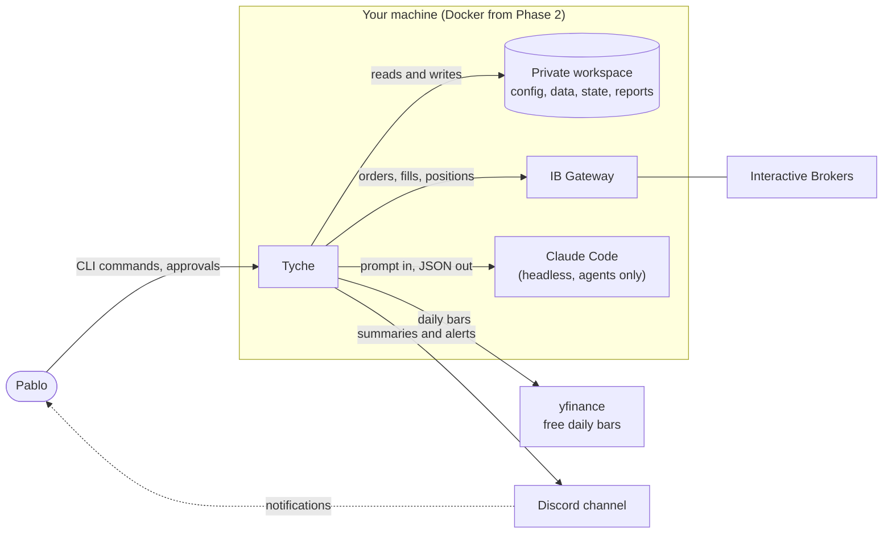
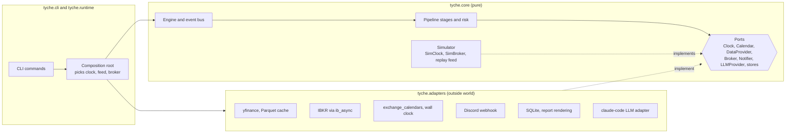
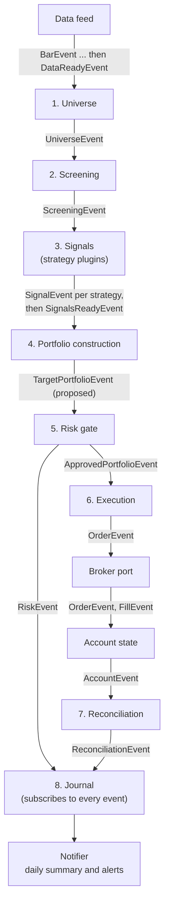
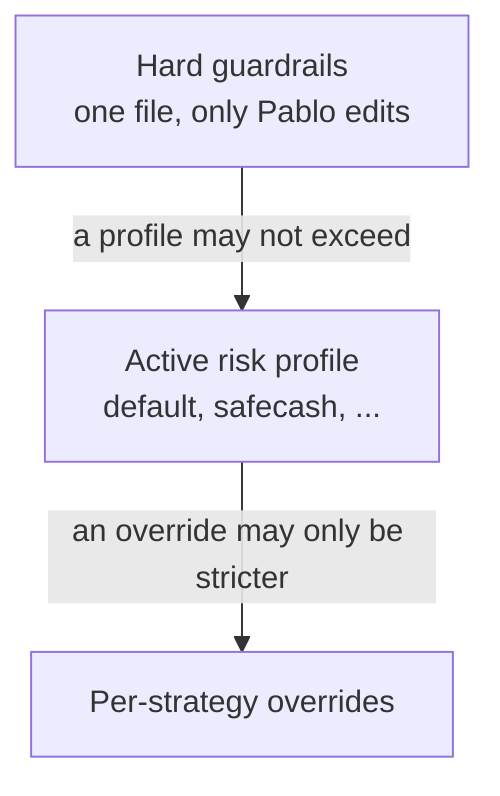

# System overview

*Status: Phase 0 design, accepted by Pablo on 2026-11-16. Phase 1 (version 0.1.0) implements the trading path for backtests: data, universe, screening, signals, portfolio, a pass-through risk gate, execution, the simulated broker and an in-memory journal. Risk rules, reconciliation, paper and live trading, stored state, notifications and agents come in later phases; the [event catalog](event-catalog.md) marks what each event's status is, and [`STATUS.md`](../../STATUS.md) what works today.*

This is the one document to read to understand how Tyche is put together. Each section links to the ADR that records the decision behind it.

## 1. What Tyche is

Tyche is a trading framework that runs on your own machine. It has two separate halves:

- **The trading path** turns market data into orders: `data → universe → screening → signals → portfolio → risk → execution → reconciliation → journal`. It is plain, deterministic, tested Python. No LLM is involved.
- **The improvement loop** runs offline. LLM agents read the journal and reports and write *proposals* as files. A proposal changes nothing until it has passed an automated backtest gate and you have approved it.

The two halves share data through files and the database, never through function calls. CI enforces that the trading path cannot import agent code ([ADR-0007](../adr/0007-python-driven-agents.md)).

## 2. System context



## 3. Core, ports and adapters

Tyche uses a ports-and-adapters (hexagonal) structure ([ADR-0004](../adr/0004-hexagonal-architecture.md)). The rule is about purity:

- **`tyche.core`** is pure code. It does no network or disk I/O, never reads the wall clock and never imports a vendor library.
- **Ports** (`tyche.core.ports`) are the interfaces the core uses to reach the outside world: `Clock`, `Calendar`, `DataProvider`, `Broker`, `Notifier`, `LLMProvider` and the storage ports.
- **Adapters** (`tyche.adapters`) implement ports against a real vendor, the network, the disk or the wall clock.
- **The runtime** (`tyche.runtime`) is the only place that knows both sides. It picks adapters and hands them to the core.



The simulated clock, feed and broker are pure code we write ourselves, so they live in `tyche.core.sim`, not in `tyche.adapters`.

Six import-linter contracts in `pyproject.toml` turn these rules into CI failures. The folder-by-folder map is in the [repo map](../developer-guide/repo-map.md).

## 4. One engine, three modes

Backtest, paper and live run the same engine and the same pipeline stages ([ADR-0005](../adr/0005-backtest-paper-live-parity.md)). The runtime swaps exactly three things:

| Mode | Clock | Data feed | Broker |
|---|---|---|---|
| Backtest | `SimClock` (jumps from event to event) | Historical replay from the Parquet cache | `SimBroker` |
| Paper | Wall clock | Live feed (fetch after the close) | `IBKRBroker` on the paper account |
| Live | Wall clock | Live feed | `IBKRBroker` on the live account, only after the manual gate in [ADR-0013](../adr/0013-live-trading-gate.md) |

Parity means the *code path* is the same. It does not mean simulated fills match real ones; the limits are listed in section 9.

The engine's loop (`tyche.core.engine`) is the same in every mode: take the next input from the `Feed`, ask the clock to `wait_until` its moment, publish it, drain the bus. A `SimClock` jumps to the moment; the wall clock (Phase 2) sleeps until it. That is the `PacedClock` port, and it is why the engine never needs to know which mode it is in.

## 5. The event flow

Components never call each other. Each one subscribes to the events it needs and publishes the events it produces, through a synchronous, single-threaded bus ([ADR-0003](../adr/0003-synchronous-event-bus.md)). The full list of events is in the [event catalog](event-catalog.md).



Three properties of this flow matter most:

1. **Risk cannot be bypassed, by construction.** Portfolio construction publishes a *proposed* `TargetPortfolioEvent`. Execution only accepts `ApprovedPortfolioEvent`, and only the risk gate creates one ([ADR-0006](../adr/0006-target-positions-with-optional-stops.md)).
2. **The run is deterministic.** The engine takes the next input from the feed only when the event queue is empty, so everything caused by one input is finished before the next arrives. The same inputs always produce the same sequence of events.
3. **The journal is the event log.** The journal subscribes to every event and stores it with its cause. Reports, the Discord summary and the weekly review all read from it.

### An end-of-day cycle, step by step

The timeframe is a field on the bar, and nothing in the core assumes one bar per day. For the end-of-day setup in Phases 1 and 2, one cycle looks like this:

```mermaid
sequenceDiagram
    autonumber
    participant F as Data feed
    participant B as Broker (Sim or IBKR)
    participant P as Pipeline stages 1 to 4
    participant R as Risk gate
    participant X as Execution
    participant J as Journal and notifier

    Note over F,J: Session t+1 has closed (plus the configured buffer)
    F->>B: BarEvent for session t+1, per instrument
    B->>J: FillEvent for orders decided at close t (filled at the open of t+1), and any stop that triggered
    B->>X: FillEvent: split between sleeves; a filled entry gets its protective stop, working from t+2
    X->>R: AccountEvent at the close of t+1 (Tyche's own view of the account)
    F->>P: DataReadyEvent (all bars for t+1 delivered and quality-checked)
    P->>R: TargetPortfolioEvent (proposed), using data up to the close of t+1 only
    R->>X: ApprovedPortfolioEvent (shrunk, blocked or flattened as needed)
    R->>J: RiskEvent for every adjustment
    X->>B: OrderEvent, to fill at the open of t+2
    B->>J: Reconciliation, then daily summary
```

This is how lookahead is prevented: a decision uses data up to the close of session *t*, and its orders fill at the open of *t+1* at the earliest.

## 6. Risk and safety model

Limits are layered, and each layer can only be stricter than the one above it ([ADR-0010](../adr/0010-config-toml-pydantic.md)):



Config that breaks this ordering fails validation, and Tyche refuses to start.

Other safety mechanisms:

| Mechanism | Behaviour | Phase |
|---|---|---|
| Position sizing | With a stop: sized so a stop-out loses at most the profile's risk per trade. Always: capped by max position size and max open positions. | 2 |
| Protective stops | A target may carry a stop price. The stop rests at the broker, so it works while Tyche is not running. | 1 (sim), 2 (IBKR) |
| Daily loss limit | Measured close to close, including stop-outs and fees. When hit, the decision at that close opens no new positions ([ADR-0015](../adr/0015-daily-loss-limit.md)). | 2 |
| Drawdown kill switch | Checked every time Tyche runs. Halts everything; only a manual restart resumes. | 2 |
| Manual kill switch | `KILL` flag file plus a CLI command. No new orders; optional flatten. | 2 |
| Reconciliation halt | Internal state differs from the broker's: stop trading and alert. | 2 |
| Catch-up rule | Missing data is fetched, but a signal older than the freshness window is skipped and reported, never traded. | 2 |
| Live gate | Live mode needs a manual, interactive arming step that code and agents cannot perform. | 2 |

## 7. Where state lives

The code repository is public; your trading setup is not. Everything specific to you lives in a private workspace folder, `TYCHE_HOME`, which is its own private git repository ([ADR-0008](../adr/0008-public-code-private-workspace.md)).

```text
$TYCHE_HOME/
├── .env                 secrets (gitignored)
├── config/
│   ├── tyche.toml       market profile, active strategies and budgets, schedule
│   ├── markets/         one file per market profile (US.toml, later CA.toml, CA+US.toml)
│   ├── costs/           trading costs and settlement for each market profile, dated
│   ├── guardrails.toml  hard limits
│   ├── risk/            one file per named risk profile
│   └── strategies/      one file per strategy instance (versioned parameters)
├── strategies/          your own strategy plugins (optional)
├── research/            agent research notes
├── proposals/           agent proposals, gate results, your decisions
├── reports/             backtests/<run id>/: each run's record (code, config, data, outcome), equity and fills
├── data/                market data (gitignored): bars/<source>/<timeframe>/<exchange>/<symbol>.parquet,
│                        plus yfinance's own small caches
├── state/               SQLite database and run state (gitignored)
├── logs/                structured daily logs (gitignored)
└── KILL                 kill-switch flag (present means on)
```

Storage formats are in [ADR-0009](../adr/0009-storage-sqlite-parquet.md): SQLite for operational state, Parquet for market data, DuckDB for ad hoc analysis.

## 8. Agents

Three agents (research analyst, performance reviewer, strategy proposer) run offline as Python workflows that call an LLM as a function. Their inputs and outputs are files validated against JSON Schemas. See [agent architecture](agent-architecture.md).

## 9. Assumptions and honest notes

You asked for plain statements where something is a likely way to lose money or fool yourself. These are the ones I see in the brief. Pablo reviewed them on 2026-11-16; each note ends with what was agreed.

1. **A small account is expensive to trade.** With under $1,000 CAD split over up to five positions, each position is small. A per-order minimum commission is then a large percentage of every trade, and whole-share sizing may make some targets impossible.
   *Agreed:* Phase 1 verifies IBKR Canada's current commissions and fractional-share rules and models them exactly. Every backtest report gets a cost-drag section, and Phase 1 ends with a minimum viable capital analysis: the account size at which each strategy's edge survives costs. If five positions under $1,000 CAD cannot work, the analysis will say so and propose different defaults (fewer positions, lower turnover or more capital).
   *Done in PR 19 ([ADR-0028](../adr/0028-backtest-report-html-and-cost-drag.md)):* every report has a cost-drag section, with slippage counted. On 2005 to 2023 with USD 10,000, the example mean reversion's costs were 48% of its profit before costs.
   *Measured in PR 22 ([ADR-0031](../adr/0031-minimum-viable-capital.md), proposed):* five positions under CAD 1,000 does not work. Each is about USD 140; a round trip costs 2.12% of one under Fixed and 0.84% under Tiered, and four of the nine candidate ETFs cost more than USD 140 a share today. On 2005 to 2023, the example rotation needs about USD 25,000 to run within half a point a year of a USD 100,000 account; the mean reversion USD 10,000 (Fixed) or 5,000 (Tiered), with no edge at any size. Proposed for Pablo's decision: Tiered for the real account, one or two positions below about USD 5,000, low turnover below USD 10,000.
   *Checked 2026-11-17 (PR 9):* under IBKR Pro Fixed every order of this size pays the USD 1.00 minimum or the 1% cap, about 0.5% to 1% per side; and IBKR's API cannot place fractional orders, so Tyche trades whole shares only. Facts in [IBKR Canada: costs and settlement](../developer-guide/ibkr-canada-costs-and-settlement.md); model decided in [ADR-0020](../adr/0020-cost-and-settlement-model.md).
2. **Three months of paper trading is not evidence of an edge.** For end-of-day strategies, three months is a few dozen trades at most. It proves the plumbing works.
   *Agreed:* in Phase 2 I will propose revised promotion criteria with two separate tests. The edge must be shown by walk-forward and out-of-sample backtests. Paper trading must show that live results stay close to what the backtest predicts for the same period, within a defined tracking threshold.
3. **A weekly proposal loop is an overfitting machine unless it is fenced in.** Testing a new idea against the same history every week will eventually find something that passes by luck.
   *Agreed:* every candidate ever tried is counted, a holdout period stays untouched, and results are reported with a deflated Sharpe ratio or an equivalent correction for the number of trials. The holdout is reserved from the first backtest in Phase 1; a holdout that earlier experiments have already seen is not a holdout.
   *Reserved in PR 15 ([ADR-0024](../adr/0024-backtest-runner-holdout-and-run-record.md)):* history from 2024-01-01 on, a fixed date in the workspace. Every backtest is refused if it reaches it, and every run is recorded, so trials can be counted.
4. **Cash-account settlement can block same-day rotation.** In a cash account, sale proceeds may not be usable until they settle. A rotation that sells and buys at the same open may then be partly unfunded.
   *Agreed:* Phase 1 verifies the current rule for an IBKR Canada cash account and models settled and unsettled cash in `SimBroker`.
   *Checked 2026-11-17 (PR 9):* US trades settle T+1, a cash account buys with settled cash only, and selling before a purchase settles is free riding (90 days of settled-cash-only trading). A rotation therefore takes two sessions, and a stop that triggers on the day of entry is a violation. Handling decided in [ADR-0020](../adr/0020-cost-and-settlement-model.md).
5. **Free data has real limits.** yfinance is unofficial, can change or break without notice, revises adjusted prices, and only lists companies that still exist (survivorship bias). ETF-based strategies are affected less than stock-picking ones. Every report will state these limits.
   *Done in PR 19:* every report ends with these limits, and with the data each run used.
   *Found while building the cache (PR 5), resolved in [ADR-0019](../adr/0019-split-adjusted-prices-and-cash-dividends.md):* dividend-adjusted prices are rewritten every time a dividend is paid, and Yahoo has no truly unadjusted prices. Tyche stores split-adjusted prices, keeps dividends as cash events, and refetches an instrument's history when a new split appears.
   *Seen again in the universe (PR 11):* the universe can only choose among the instruments it is given, so survivorship bias starts there; and its minimum price is compared with split-adjusted prices, which errs towards leaving a share out. Both are listed in [backtesting internals](../developer-guide/backtesting-internals.md#3-which-instruments-are-considered).
6. **Daily loss limit in an end-of-day system.** *Resolved* in [ADR-0015](../adr/0015-daily-loss-limit.md): measured close to close, including stop-outs and fees. Within a session, only a stop order resting at the broker protects a position.
7. **Tax.** Tyche will record what you need for adjusted cost base in CAD (Phase 4). It will not decide how the CRA classifies your trading; frequent trading can be treated as business income, and the superficial-loss rule affects ACB. Worth a conversation with an accountant before going live. This is not tax advice.
8. **Draft strategies written by an agent are untrusted code.** A proposed strategy file must be read and approved by you before Tyche executes it, even in a backtest.

## 10. Open decisions

Tracked in [`STATUS.md`](../../STATUS.md). The [ADR index](../adr/README.md) shows which decisions are accepted and which are still proposed.
