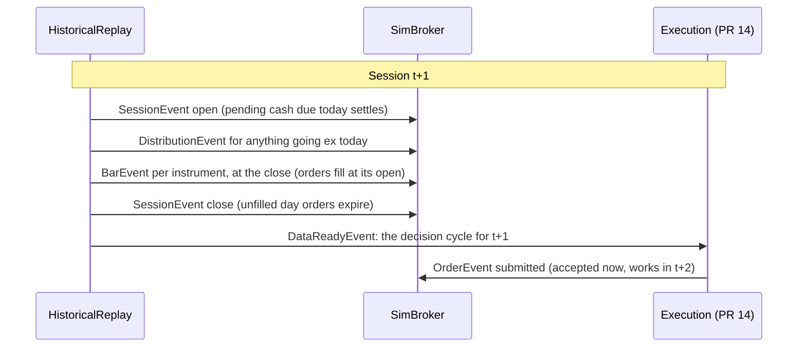

# Backtesting internals

How a backtest turns history into fills, and what it cannot know. Every rule here is a model of a real broker, chosen to be no kinder than the real one. Reports must state these rules and the parameters used ([ADR-0005](../adr/0005-backtest-paper-live-parity.md): parity of code, not of markets).

*Written in PR 10 with the simulated broker; the universe section added in PR 11. Sections on the backtest runner, metrics and walk-forward are added by PRs 15, 16 and 20.*

## 1. How time moves

`HistoricalReplay` plays each session's inputs in a fixed order, and the engine moves the simulated clock to each one before publishing it:

A bar is known only at its session's close, so the broker learns the open price of session *t+1* at the close of *t+1*. It records the fill at the open, which is when it happened, but nothing in Tyche sees it before the bar was known. A decision made at the close of *t* therefore fills at the open of *t+1* at the earliest ([lookahead bias](../learning/lookahead-bias.md)).

## 2. The simulated broker

`SimBroker` (`tyche.core.sim.broker`) implements the `Broker` port. Like IBKR, it keeps its own record of the account; Tyche's own account view (PR 14) and reconciliation (Phase 2) are separate.

### Orders

| Rule | Detail |
|---|---|
| When an order works | From the next open of its instrument's calendar after it is accepted |
| Day orders | Expire at the close of the session they worked in, with any unfilled part |
| Good-till-cancelled stops | Keep working, session after session, until they fill |
| Rejected at submission | Wrong currency for the costs, no calendar loaded, fractional quantity, a buy stop, a sale of more shares than are held |
| Repeated `client_order_id` | Ignored, and listed in `ignored_duplicates`; sending a decision twice cannot trade twice |
| Cancellation by Tyche | Not supported yet; added with execution (PR 14) |

### Fills

| Rule | Detail |
|---|---|
| Market orders | Fill at the bar's open |
| Sell stops | At the open if the open is already through the stop; otherwise at the stop price if the bar's low reaches it. A daily bar does not say when the low happened, so the stop is assumed to fill whenever the low reaches it ([ADR-0006](../adr/0006-target-positions-with-optional-stops.md)) |
| Slippage | Every fill price moves against the order by `slippage_bps` ([ADR-0020](../adr/0020-cost-and-settlement-model.md)) |
| Volume | One bar fills at most `max_volume_participation` of its volume across all orders for the instrument (default 1%). The rest of a day order expires: that is how a partial fill happens |
| Purchases | Paid from **settled cash only**. If settled cash cannot pay for the whole order at the open, costs included, the order is **cancelled**, not shrunk |
| Sales | A sale for more shares than are held when it fills is cancelled. This happens to a stop whose shares were already sold |
| Costs | `TradingCosts.cost_of` per fill: commission plus regulatory fees, recorded as the fill's `commission` |
| Settlement | `settlement_days` sessions later on the instrument's calendar. Pending cash settles at the open of its settlement date |
| Marks | Each held instrument is marked at its bar's close |
| Fill times | `filled_at` is the session's open for market orders and gap fills, and its close for a stop reached during the session |

### Free riding

Selling shares before their purchase has settled is executed, as IBKR would, and recorded in `free_riding` with the shares involved. Purchases are matched to sales oldest first. Any entry is a design problem in the strategy or execution ([ADR-0020](../adr/0020-cost-and-settlement-model.md)).

With T+1 settlement and the rules above, the simulator cannot free-ride on its own: a sale must be submitted for shares already held, and those shares were bought at least one session earlier. It becomes possible with a longer settlement period, or if execution (PR 14) attaches a stop to an entry before the entry fills. PR 14 decides how stops are placed; placing them after the entry fills, as now, leaves the entry session unprotected.

### Cash distributions

At the open of an ex-date, holders at the previous close are credited `amount_per_share × shares`, rounded to the cent, as **settled** cash (`Account.receive_distribution`). Two approximations, both slightly flattering:

- The payment date is not known (Yahoo does not report it), so the cash arrives days or weeks early ([ADR-0019](../adr/0019-split-adjusted-prices-and-cash-dividends.md)).
- No withholding tax is deducted. US dividends paid to a Canadian resident are subject to it; the rate and IBKR's handling are verified before it is modelled (Phase 2 or 4).

## 3. Which instruments are considered

Before any strategy sees an instrument, the universe stage (`tyche.core.pipeline.universe`) decides whether it is eligible at that decision time, using the `[universe]` rules of the market profile (`config/markets/<PROFILE>.toml`). It decides from the bars and data issues already published, never by asking the data provider, so it cannot see the future ([state built from events](../learning/state-built-from-events.md)).

The rules are checked in this order. The first one an instrument fails is its reason in the `UniverseEvent`:

| # | Rule | Excluded as | `US` default |
|---|---|---|---|
| 1 | Calendar is one of the profile's, quoted in the thresholds' currency, asset class allowed | `not_in_profile` | XNYS; USD; stocks and ETFs |
| 2 | Has a bar for this decision time | `no_bar` | |
| 3 | No disqualifying data issue (missing session, conflicting or invalid bars, suspect move) reported in this cycle or the previous `quality_sessions - 1` ([ADR-0018](../adr/0018-audit-market-data.md)) | `data_issue` | 5 cycles |
| 4 | At least `liquidity_sessions` bars so far | `insufficient_history` | 20 bars |
| 5 | Last close at least `min_price` | `price_too_low` | USD 5.00 |
| 6 | Mean of close × volume over the last `liquidity_sessions` bars at least `min_average_dollar_volume` | `illiquid` | USD 10,000,000 |

The thresholds are choices, not market facts. Screening (`tyche.core.pipeline.screening`) then ranks the eligible instruments; the only screen so far, `dollar_volume`, ranks by liquidity and says nothing about which instrument will do well.

What follows from the rules:

- **Warm-up.** Nothing is eligible until `liquidity_sessions` bars have arrived. A backtest must start its replay that many sessions before the first day it measures (PR 15).
- **Split-adjusted minimum price.** Prices before a split are divided by its ratio, so a share that traded above the minimum can read below it and be excluded. This errs towards excluding. Dollar volume is not affected: the split adjustment cancels out in close × volume.
- **Survivorship.** The universe can only choose among the instruments the replay was given. Yahoo lists only instruments that still exist, so a backtest over today's symbols never meets a company that failed.
- **Old gaps are forgiven.** A bar missing more than `quality_sessions` cycles ago no longer excludes the instrument, and its liquidity average then spans a few more sessions than `liquidity_sessions`.

## 4. Known limits

| Limit | Effect | Plan |
|---|---|---|
| **Splits.** Prices, volumes and dividends are split-adjusted, so before a split the simulation trades adjusted shares | Whole-share sizing applies to adjusted shares. Before a 10-for-1 split, one simulated share is a tenth of a real one, so a small account may hold a position it could not have bought | Rare for the ETFs of Phase 1. Revisit if a strategy trades single stocks across splits |
| **No intraday order of events** | A stop and a market order on the same bar are processed in submission order, not in the order they would have happened | Pessimistic stop rule; intraday data in Phase 6 |
| **Liquidity** | Volume participation is a cap, not a market-impact model | Never binding at this account's size |
| **Settlement calendar** | T+n counts exchange sessions; the settlement system's business days may differ on a few dates | See `tyche.core.sim.settlement` |
| **The open price** | A market order fills at the bar's open, the official opening price. A real order at the open may fill elsewhere | Measured in paper trading (Phase 2) |
