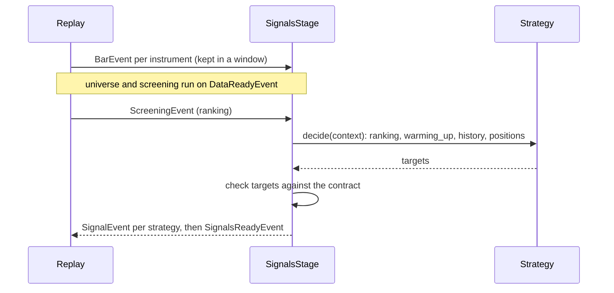
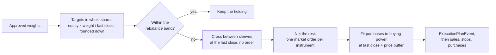
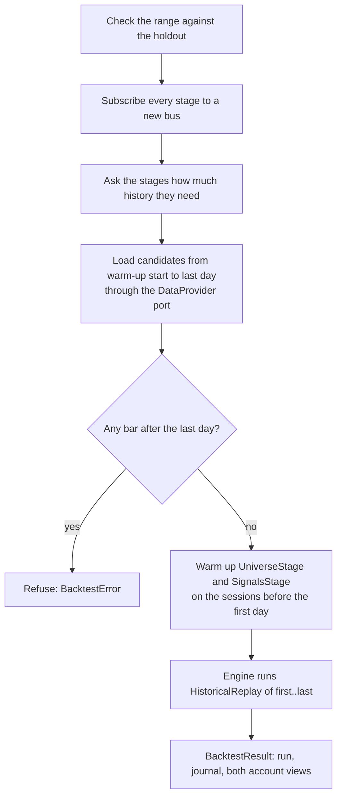
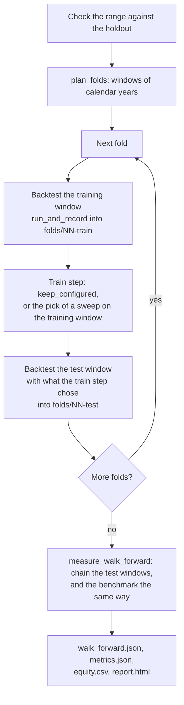
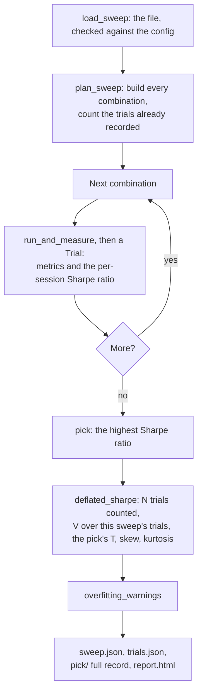
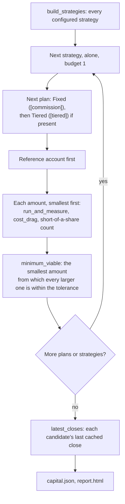

# Backtesting internals

How a backtest turns history into fills, and what it cannot know. Every rule here is a model of a real broker, chosen to be no kinder than the real one. Reports must state these rules and the parameters used ([ADR-0005](../adr/0005-backtest-paper-live-parity.md): parity of code, not of markets).

*Written in PR 10 with the simulated broker; the universe section added in PR 11, the strategy section in PR 12, the portfolio section in PR 13, the execution section in PR 14, the runner section in PR 15, the metrics section in PR 16, the reference check in PR 17, the walk-forward section in PR 20 and the sweeps section in PR 21.*

## 1. How time moves

`HistoricalReplay` plays each session's inputs in a fixed order, and the engine moves the simulated clock to each one before publishing it:

```mermaid
sequenceDiagram
    participant R as HistoricalReplay
    participant B as SimBroker
    participant A as AccountState
    participant X as Execution

    Note over R,X: Session t+1
    R->>B: SessionEvent open (pending cash due today settles, in both account views)
    R->>B: DistributionEvent for anything going ex today
    R->>B: BarEvent per instrument, at the close (orders fill at its open)
    B->>X: FillEvent: the sleeve book updates; a filled entry gets its stop now
    R->>B: SessionEvent close (unfilled day orders expire)
    A->>X: AccountEvent: Tyche's account at the close
    R->>X: DataReadyEvent: the decision cycle for t+1, through risk to execution
    X->>B: OrderEvent submitted (accepted now, works in t+2)
```

A bar is known only at its session's close, so the broker learns the open price of session *t+1* at the close of *t+1*. It records the fill at the open, which is when it happened, but nothing in Tyche sees it before the bar was known. A decision made at the close of *t* therefore fills at the open of *t+1* at the earliest ([lookahead bias](../learning/lookahead-bias.md)).

## 2. The simulated broker

`SimBroker` (`tyche.core.sim.broker`) implements the `Broker` port. Like IBKR, it keeps its own record of the account; Tyche's own account view (`AccountState`, section 6) and reconciliation (Phase 2) are separate.

### Orders

| Rule | Detail |
|---|---|
| When an order works | From the next open of its instrument's calendar after it is accepted |
| Day orders | Expire at the close of the session they worked in, with any unfilled part |
| Good-till-cancelled stops | Keep working, session after session, until they fill |
| Rejected at submission | Wrong currency for the costs, no calendar loaded, fractional quantity, a buy stop, a sale of more shares than are held |
| Repeated `client_order_id` | Ignored, and listed in `ignored_duplicates`; sending a decision twice cannot trade twice |
| Cancellation by Tyche | A `CancelRequestEvent` cancels an open order at once, with the reason in its note. A request for an order already finished is ignored; one for an order never submitted halts the run |

### Fills

| Rule | Detail |
|---|---|
| Market orders | Fill at the bar's open |
| Sell stops | At the open if the open is already through the stop; otherwise at the stop price if the bar's low reaches it. A daily bar does not say when the low happened, so the stop is assumed to fill whenever the low reaches it ([ADR-0006](../adr/0006-target-positions-with-optional-stops.md)) |
| Slippage | Every fill price moves against the order by `slippage_bps` ([ADR-0020](../adr/0020-cost-and-settlement-model.md)) |
| Volume | One bar fills at most `max_volume_participation` of its volume across all orders for the instrument (default 1%). The rest of a day order expires: that is how a partial fill happens |
| Purchases | Paid from **settled cash only**: the account's buying power, settled cash minus purchases not settled yet, so two purchases at one open cannot spend the same cash. If it cannot pay for the whole order at the open, costs included, the order is **cancelled**, not shrunk |
| Sales | A sale for more shares than are held when it fills is cancelled. This happens to a stop whose shares were already sold |
| Costs | `TradingCosts.cost_of` per fill: commission plus regulatory fees, recorded as the fill's `commission` |
| Settlement | `settlement_days` sessions later on the instrument's calendar. Pending cash settles at the open of its settlement date |
| Marks | Each held instrument is marked at its bar's close |
| Fill times | `filled_at` is the session's open for market orders and gap fills, and its close for a stop reached during the session |

### Free riding

Selling shares before their purchase has settled is executed, as IBKR would, and recorded in `free_riding` with the shares involved. Purchases are matched to sales oldest first. Any entry is a design problem in the strategy or execution ([ADR-0020](../adr/0020-cost-and-settlement-model.md)).

With T+1 settlement and the rules above, the simulator cannot free-ride on its own: a sale must be submitted for shares already held, and those shares were bought at least one session earlier. Execution keeps it that way by placing a stop only when its entry fills, so the stop works from the next session ([ADR-0023](../adr/0023-execution-sleeves-stops-and-cash.md)). The cost is that the entry session has no stop. Free riding becomes possible again only with a longer settlement period.

### Cash distributions

At the open of an ex-date, holders at the previous close are credited `amount_per_share × shares`, rounded to the cent, as **settled** cash (`Account.credit`, which Tyche's own account view uses too). Two approximations, both slightly flattering:

- The payment date is not known (Yahoo does not report it), so the cash arrives days or weeks early ([ADR-0019](../adr/0019-split-adjusted-prices-and-cash-dividends.md)).
- No withholding tax is deducted. US dividends paid to a Canadian resident are subject to it; the rate and IBKR's handling are verified before it is modelled (Phase 2 or 4).

## 3. Which instruments are considered

Before any strategy sees an instrument, the universe stage (`tyche.core.pipeline.universe`) decides whether it is eligible at that decision time, using the `[universe]` rules of the market profile (`config/markets/<PROFILE>.toml`). It decides from the bars and data issues already published, never by asking the data provider, so it cannot see the future ([state built from events](../learning/state-built-from-events.md)).

The rules are checked in this order. The first one an instrument fails is its reason in the `UniverseEvent`:

| # | Rule | Excluded as | `US` default |
|---|---|---|---|
| 1 | Calendar is one of the profile's, quoted in the thresholds' currency, asset class allowed | `not_in_profile` | XNYS; USD; stocks and ETFs |
| 2 | Has a bar for this decision time | `no_bar` | |
| 3 | No disqualifying data issue (missing session, conflicting or invalid bars, suspect move) reported in this cycle or the previous `quality_sessions - 1` ([ADR-0018](../adr/0018-audit-market-data.md)) | `data_issue` | 5 cycles |
| 4 | At least `liquidity_sessions` bars so far | `insufficient_history` | 20 bars |
| 5 | Last close at least `min_price` | `price_too_low` | USD 5.00 |
| 6 | Mean of close × volume over the last `liquidity_sessions` bars at least `min_average_dollar_volume` | `illiquid` | USD 10,000,000 |

The thresholds are choices, not market facts. Screening (`tyche.core.pipeline.screening`) then ranks the eligible instruments; the only screen so far, `dollar_volume`, ranks by liquidity and says nothing about which instrument will do well.

What follows from the rules:

- **Warm-up.** Nothing is eligible until `liquidity_sessions` bars have arrived. A backtest must start its replay that many sessions before the first day it measures (PR 15).
- **Split-adjusted minimum price.** Prices before a split are divided by its ratio, so a share that traded above the minimum can read below it and be excluded. This errs towards excluding. Dollar volume is not affected: the split adjustment cancels out in close × volume.
- **Survivorship.** The universe can only choose among the instruments the replay was given. Yahoo lists only instruments that still exist, so a backtest over today's symbols never meets a company that failed.
- **Old gaps are forgiven.** A bar missing more than `quality_sessions` cycles ago no longer excludes the instrument, and its liquidity average then spans a few more sessions than `liquidity_sessions`.

## 4. What a strategy sees

The signals stage (`tyche.core.pipeline.signals`) asks each strategy to decide once per decision cycle, after screening ([ADR-0021](../adr/0021-strategies-see-a-window-handed-in.md)). A strategy is handed a `StrategyContext` and nothing else: no bus, clock or data provider.



- **The window.** Each strategy declares a `timeframe` (daily only in Phase 1) and a `lookback`. For every ranked instrument it has `lookback` bars of, the context holds exactly that many, ending at the decision time. Windows are keyed by instrument and timeframe.
- **Warm-up.** A ranked instrument with fewer bars is not offered. It is listed in `warming_up` and in the strategy's `SignalEvent`, and the history view raises if asked for it. A partial window is never handed out.
- **One warm-up path.** `SignalsStage.warm_up(histories, through=...)` fills the windows from cached `BarHistory` up to a moment, before the run's first event. The backtest runner (PR 15) uses it so a strategy has full windows on the first measured day; paper and live use it at every start (Phase 2). `history_needed` says how many bars to fetch.
- **Splits rebuild, dividends do nothing.** A window holds one adjustment basis. A bar on another basis halts the run. Windows are never restated in place: after a split refetch they are rebuilt from the cache.
- **Positions.** The context's `positions` lists the strategy's own holdings (entry date, average entry price, the stop resting for them), so a stateless strategy can tell an entry from a hold. They come from execution's sleeve book (section 6).
- **Targets.** Weights are exact `Decimal`s from 0 to 1, adding up to at most 1 of the strategy's budget; only offered instruments may be targeted, each once; a stop must be below the last close. An offered instrument left out means zero. A held instrument not offered this cycle (a data gap) keeps its position: portfolio construction carries it over (PR 13).
- **Failures.** A strategy that raises or breaks the rules is listed in `SignalsReadyEvent.failed` and publishes nothing that cycle. The run goes on.

The benchmark, `BuyAndHold` (`tyche.strategies`), puts its whole budget in one instrument, SPY for the `US` profile, whenever it is eligible.

## 5. How strategies share the account

Portfolio construction (`tyche.core.pipeline.portfolio`) turns each cycle's signals into one proposed `TargetPortfolioEvent`, in **weights of account equity**, not shares ([ADR-0022](../adr/0022-portfolio-targets-as-weights-in-sleeves.md)).

- **Budgets.** Each strategy has a budget in `config/tyche.toml`, a fraction of equity; together at most 1, the rest is cash. A strategy's weight is a fraction of its own budget, so its contribution to an instrument is `budget × weight`.
- **Sleeves.** Each strategy has a sleeve: its budget, whether it decided or failed this cycle, and the instruments it decided on. Execution tracks holdings per sleeve and nets orders across sleeves (section 6).
- **Shared instruments add up.** Buy-and-hold SPY with 0.4 and a trend strategy wanting half of its 0.6 budget in SPY give SPY a target of 0.7, as two contributions. Each keeps its own stop, so only the trend strategy's shares get a stop order.
- **Keep, zero or weight.** For each sleeve and instrument: a contribution gives its weight; an instrument the sleeve decided on without a contribution gives zero; anything else the sleeve holds (not offered this cycle, or the strategy failed) is kept. The stage keeps nothing between cycles, so a restart cannot turn a keep into a sale.
- **Sizing comes last.** Risk works in weights (below). Execution turns approved weights into whole shares from the account's equity, settled cash and costs, rounding down, so rounding can never push a position past a risk limit at the close it was sized at.

### The risk gate

`RiskGate` (`tyche.core.risk`) applies the active risk profile, and each strategy's own `[risk]` table, to every proposed portfolio ([ADR-0033](../adr/0033-risk-gate-position-rules.md)). It only lowers or removes contributions, in this order:

1. **Each contribution on its own:** a strategy's own position cap; then **risk per trade**, on entries and additions with a stop, at most `risk_per_trade × close / (close − stop)` of equity, never below what the sleeve already holds.
2. **Open positions,** per sleeve (a strategy's own count), then for the account: what stays held keeps its place, new entries fill what is free, largest weight first, ties by symbol. A holding sold to zero frees its place.
3. **Position size for the account:** each instrument across every sleeve, counting what sleeves keep without deciding; above the cap, every contribution shrinks by the same proportion.

Each cut is a `RiskEvent`, and the `ApprovedPortfolioEvent` lists them all in `adjustments`. The rules are the pure function `review`; `RiskGate` only gathers its inputs (the closes, the account snapshot of the same close, the sleeve book's holdings as weights) and publishes. A backtest uses `--risk-profile`, `default` when not given, and records it.

## 6. From approved weights to orders

The risk gate (`tyche.core.risk`) is the only publisher of `ApprovedPortfolioEvent`, and execution (`tyche.core.pipeline.execution`) acts on nothing else ([ADR-0006](../adr/0006-target-positions-with-optional-stops.md)). The gate's rules are in section 5. The rules below are [ADR-0023](../adr/0023-execution-sleeves-stops-and-cash.md); the two parameters are in `[execution]` of `config/markets/<PROFILE>.toml`.



| Rule | Detail | `US` default |
|---|---|---|
| Account view | `AccountState` applies the same fills, settlements and distributions as the broker, to the same ledger, marks every holding at the close and publishes an `AccountEvent`. Execution sizes from it | |
| Reading the portfolio | Per sleeve and instrument: a contribution's weight; zero for an instrument decided on and not targeted; otherwise keep (ADR-0022) | |
| Sizing | `whole_shares(equity × weight, last close)`. A positive weight worth less than one share is a target of zero | |
| Rebalance band | A holding within `rebalance_band × target` of its target is kept. Entries and exits always trade | 10% |
| Crossing | Shares one sleeve gives up and another wants change sleeve at the last close, with no order and no commission | |
| Netting | What does not cross is one market day order per instrument, for the sleeves on its side | |
| Cash | Purchases together must fit the buying power at the next open, costed at the last close × (1 + `price_buffer`), slippage and costs included. Otherwise each shrinks in proportion, then the largest loses one share at a time | 2% |
| Fills | Split between the sleeves an order serves in proportion to what each is still owed, in whole shares; leftovers to the largest remainders, ties to the earlier strategy id | |
| Stops | Placed when the entry fills, good till cancelled, for all the sleeve's shares; working from the next session. At each decision a stop with the wrong price or size is cancelled and placed again, and one no longer wanted is cancelled | |
| Order ids | `<decision time>-<symbol>.<exchange>-<side>`, `...-stop-<strategy>`, or `<fill id>-stop-<strategy>`. A decision handled once is not handled again | |
| Halts | No account snapshot from the decision's close, a market order still open at a decision, or sleeves that do not add up to the account's positions | |

What follows from the rules:

- **Fully invested is about 98%.** Buy-and-hold at 1.0 buys what the cash pays for at the close plus 2%, then sits inside the band. Reports state both parameters.
- **A rotation takes two sessions**, as ADR-0020 says: the sale's proceeds pay for the purchase only from the session after the sale settles.
- **Per-strategy attribution is approximate where sleeves cross**: shares change sleeve at the decision's close, not at the next open. The account's totals are exact.
- **The plan explains itself.** Each decision's `ExecutionPlanEvent` lists, per sleeve and instrument, what it held, its target, what crossed and what was ordered, and why it differs from its weight: `keep`, `within_band`, `below_one_share` or `cash_limited`.

## 7. The backtest runner

`tyche.core.backtest.run_backtest` runs one `BacktestSpec` ([ADR-0024](../adr/0024-backtest-runner-holdout-and-run-record.md)). It is wiring only: every stage is the one paper and live will use, and the three backtest parts are swapped in.



| Rule | Detail |
|---|---|
| Holdout | `BacktestSettings.require_before_holdout(last)`: a run whose last day is on or after `holdout_starts` is refused before anything is built or read. A provider returning a bar after the last day stops the run too |
| Candidates | `MarketProfile.universe.instruments`, loaded in the order listed |
| Benchmark | `MarketProfile.benchmark`, loaded over the same days through the same provider, or the candidate's own history when it is one. With no bar at or before the first close, the run is refused |
| Warm-up length | `max(UniverseStage.history_needed, SignalsStage.history_needed)`: the liquidity average, the data-issue memory and each strategy's lookback. For the template, 20 sessions |
| Warm-up | `UniverseStage.warm_up` learns the bars and data issues of those sessions as if they had been played; `SignalsStage.warm_up` fills the windows with bars up to the first open (ADR-0021). Nothing is published; nothing trades. A calendar that starts too late gives a shorter warm-up, and the first decisions wait |
| Clock | `SimClock` starts at the first session's open |
| Starting account | `starting_cash`, settled, in both the broker's and Tyche's account view |
| Result | The engine's `RunResult`, the sessions replayed and learned, the histories, the journal, Tyche's account and the broker's, free-riding violations. `closes` is the account at every close; `fills` every fill |
| Halts | A stage failing closed stops the engine; the runner returns the result anyway, with `run.completed` false and the reason |

The runtime (`tyche.runtime.backtest`) supplies the New York calendar, the Parquet cache read through `CacheOnlySource` (never fetches, raises `NotCachedError` with the missing range), the system clock and the code version, measures the run (`measure_backtest`), then writes the record: `reports/backtests/<run id>/run.json`, `equity.csv`, `fills.csv` and `metrics.json`. The user guide lists what each holds ([running a backtest](../user-guide/03-running-a-backtest.md#the-record)).

What follows from the rules:

- **Two runs on the same cache, config and code give the same fills and the same equity curve.** Nothing in a run reads the wall clock except the record's start and end times and its id.
- **Buy-and-hold carries a cash drag.** Dividends arrive as cash and are reinvested only when the holding falls more than the rebalance band below its target. On SPY from 2005 to 2023 the run ends with about 9% in cash, so Tyche's buy-and-hold trails the benchmark, SPY's total return, by about half a point of CAGR (section 8).

## 8. Metrics

`tyche.core.backtest.metrics` measures a run and its benchmark the same way ([ADR-0025](../adr/0025-metrics-against-the-benchmarks-total-return.md)). The module docstring defines every figure; this table is where each input comes from.

| Input | Source |
|---|---|
| The run's equity | `BacktestResult.closes`: Tyche's `AccountEvent` at every session close, as `EquityPoint`s (equity and the value invested) |
| The benchmark's equity | `benchmark_points(result.benchmark, closes, first equity)`: units bought at the latest close at or before the first close, each distribution reinvested at the close of the first bar on or after its ex-date, valued at the latest bar at or before each close |
| Trades | `closed_trades(result.fills)`: flat to flat per instrument, across sleeves |
| Turnover and costs | Every fill's value before costs, and its commission and fees |

`measure` takes plain inputs, so a later tool can measure a record from `equity.csv` and `fills.csv` without rerunning it. Arithmetic is `Decimal` in a fixed 28-digit context; ratios that cannot be computed are `None`.

The golden-file test `tests/integration/test_backtest_to_metrics.py` pins every figure of a fixed run. A change anywhere in the trading path that moves a number fails it; regenerate it only on purpose (learning note: [golden-file tests](../learning/golden-files.md)).

### The report

`tyche backtest` writes `report.html` into each measured run's record folder, and `tyche report <run id>` rebuilds it ([ADR-0028](../adr/0028-backtest-report-html-and-cost-drag.md), learning note: [reports built from the record](../learning/reports-from-the-record.md)). It is built from the record alone:

| Part | Where |
|---|---|
| Reading the record, assembling the sections | `tyche.runtime.report` |
| Cost drag: every cost paid to date added back at each close, slippage worked back from fill prices | `tyche.core.backtest.cost_drag` |
| Returns by calendar year | `tyche.core.backtest.years` |
| HTML and charts (matplotlib, inline SVG, deterministic) | `tyche.adapters.reports` |

### Checked against an independent engine

`tests/reference/` runs one simple strategy through Tyche and through backtesting.py on the same bars and compares every fill, the equity at every close, every closed trade and the metrics ([ADR-0026](../adr/0026-reference-validation-against-backtesting-py.md), learning note: [reference validation](../learning/reference-validation.md)). They agree to within 10⁻⁹ USD. What the comparison covers: next-open fills, whole-share sizing from the last close, IBKR Pro Fixed commissions, slippage on both sides, cash and equity accounting, trades and the metrics. What it does not, because backtesting.py does not model it: dividends, T+1 settlement, regulatory fees, the volume cap, stops, and more than one instrument or sleeve.

## 9. Walk-forward

`tyche walk-forward` runs a walk-forward ([ADR-0029](../adr/0029-walk-forward-folds-and-a-train-step.md), learning note: [walk-forward testing](../learning/walk-forward-testing.md)). It is made of backtests: every training and test window runs through the same path as `tyche backtest`.



| Rule | Detail |
|---|---|
| Folds | `plan_folds(first, last, FoldScheme)`, dates only. The first test year is `first.year + train_years`; test windows of `test_years` follow with no gap until `last`. Anchored training windows start at `first`; rolling ones keep `train_years` calendar years |
| Each window | A backtest of its own, from `starting_cash`, warmed up on the history before it like any backtest. It writes a full record into `folds/<NN>-train/` or `folds/<NN>-test/`, with `part_of` in `run.json` naming the walk-forward, the fold and the window |
| Train step | Without `--sweep`, `tyche.runtime.walk_forward.keep_configured(config, fold, trained)` returns the configured strategies, so the training run is measured and reported but changes nothing. With `--sweep <name>`, `run_sweep` runs every combination on the training window; `folds/<NN>-train/` holds the pick's full record and `trials.json`, and the test window runs the pick (section 10) |
| Joining | `chain` scales each test window's equity (and the amount invested) to start where the previous one ended. The benchmark's equity for each test window comes from that window's `metrics.benchmark_equity` and is chained the same way |
| Stops | The first window that halts or cannot be measured stops the walk-forward; `walk_forward.json` records the failure and the folds finished. Missing history raises after recording the same |
| Report | `tyche.runtime.walk_forward_report`, built from the folder alone through `tyche.adapters.reports`. `tyche report <id>` finds a walk-forward under `reports/walk_forward/` |

What follows from the rules:

- **A test window starts flat.** Its first session's close is the first equity point, before any order has filled, for the strategies and the benchmark alike. Joined, the session between two windows shows no change for either.
- **With the train step keeping the configured parameters, each anchored training window is the start of the next one.** On real data, fold 13's training run (2005 to 2021) matched the first 4,280 closes of fold 14's (2005 to 2022) in every equity row and every fill, for all three strategies. That is also a lookahead check: where a run ends changes nothing before it. The walk-forward still runs every window, because a parameter choice will make them differ.
- **Speed.** About ten times a single backtest of the same range with the defaults. On the nine-ETF profile, a walk-forward over 2005 to 2023 takes 2 to 3 minutes; with a sweep, multiply by the number of combinations.

## 10. Parameter sweeps

`tyche sweep <name>` runs every combination of `config/sweeps/<name>.toml` ([ADR-0030](../adr/0030-parameter-sweeps-trial-count-and-deflated-sharpe.md), learning note: [multiple testing](../learning/multiple-testing.md)). Each combination is a backtest through `run_and_measure`, the same path as `tyche backtest` without the record.



| Rule | Detail |
|---|---|
| Grid | `Grid` keeps the parameters in the order written; `combinations` changes the last one fastest and numbers them from 1. Values are what the strategy file would hold, merged over its parameters by `build_strategies(config, overrides)` |
| Checks | `plan_sweep` builds every combination through the plugin before anything runs, so a bad value fails with the sweep file named and nothing written |
| Trials | `trial_key(plugin, version, parameters)` hashes the full parameters. `recorded_trial_keys` reads every `run.json` (its `strategies[].parameters`, or for older records the strategy file in its config snapshot), every `trials.json` and every `capital.json` under `reports/`. `N` is the union with the grid's keys |
| Order | The combination whose strategy has the longest `lookback` (`SweepPlan.longest`) runs first, so missing history fails before other trials spend time; the rest follow in the grid's order, and trials are returned in it |
| Pick | `pick`: the highest annualised Sharpe ratio, the first in the grid on a tie, never a trial without one. Only the best run so far stays in memory |
| Deflation | `deflated_sharpe(moments, sharpes, trials)`: equations 1 and 2 of Bailey and López de Prado (2014), in `float` with `statistics.NormalDist`; Sharpe ratios per session. `V` is the sample variance of this sweep's per-session Sharpe ratios; skewness and kurtosis (3 if normal) are of the pick's daily returns |
| Record | `trials.json` holds every trial's parameters, key and metrics; only the pick keeps `run.json`, `metrics.json`, `equity.csv` and `fills.csv`, in `pick/` (in a walk-forward, in `folds/<NN>-train/` itself) |

## 11. Minimum viable capital

`tyche capital` runs each configured strategy alone, with a budget of the whole account and its configured parameters, at every amount asked for and on a large reference account, under every pricing plan the costs file holds ([ADR-0031](../adr/0031-minimum-viable-capital.md), learning note: [what account size costs](../learning/account-size.md)). Each run goes through `run_and_measure` with a copy of the configuration whose `starting_cash` and `costs` are replaced (`dataclasses.replace`); nothing else changes, so the config hash in the record still names the workspace's files.



| Rule | Detail |
|---|---|
| Size penalty | `size_penalty`: the reference run's CAGR minus the amount's, after costs, under the same plan |
| Viable | `is_viable`: the penalty within the tolerance **either way**. A small account far ahead of the large one ran a different strategy, by luck in when it could afford a share |
| Minimum | `minimum_viable`: walk the amounts from the largest down and stop at the first that is not viable; `None` if the largest is not, or the reference was not measured |
| Tiered | `TieredSchedule.commission`: the commission (minimum 0.35, maximum 1%), rounded to the cent like Fixed, plus pass-through fees on it, clearing (capped at 0.5%) and an assumed exchange fee per share, those fees rounded up to the cent together. First volume tier only. `TradingCosts.commission` is either plan (`Commission`), so the simulator and sizing need no change |
| Short of a share | The number of `ExecutionPlanEvent`s with a `PlanLine` marked `BELOW_ONE_SHARE` |
| Today's prices | `latest_closes` loads each candidate's cache entry and reads its last bar's close and date, which may be inside the holdout. Nothing is run on it; `whole_shares_today` sizes one of `positions` equal positions with `affordable_shares` |
| Arithmetic | `round_trip_cost`: buy with `affordable_shares`, sell at the same price, both orders' commission and fees plus slippage, over the shares' value; at USD 100 a share, for 1 to `positions` positions |
| Trials | `capital.json` lists each strategy's `trial_key`; `recorded_trial_keys` reads it. The configured parameters only, so a strategy already backtested adds nothing |

## 12. Known limits

| Limit | Effect | Plan |
|---|---|---|
| **Splits.** Prices, volumes and dividends are split-adjusted, so before a split the simulation trades adjusted shares | Whole-share sizing applies to adjusted shares. Before a 10-for-1 split, one simulated share is a tenth of a real one, so a small account may hold a position it could not have bought | Rare for the ETFs of Phase 1. Revisit if a strategy trades single stocks across splits |
| **No intraday order of events** | A stop and a market order on the same bar are processed in submission order, not in the order they would have happened | Pessimistic stop rule; intraday data in Phase 6 |
| **Liquidity** | Volume participation is a cap, not a market-impact model | Never binding at this account's size |
| **Settlement calendar** | T+n counts exchange sessions; the settlement system's business days may differ on a few dates | See `tyche.core.sim.settlement` |
| **Benchmark dates** | Distributions are matched to bars by the bar's UTC date. Right for US closes, which are before midnight UTC; a market closing after midnight UTC would need the session day | Revisit with the first non-US profile (Phase 4) |
| **The open price** | A market order fills at the bar's open, the official opening price. A real order at the open may fill elsewhere | Measured in paper trading (Phase 2) |
| **Future splits scale backtest windows** | Bars are adjusted for every split known when they were fetched, so before a later split a strategy's window reads lower than the prices that traded. Ratios (returns, crossovers, ranks) are unaffected; a fixed price threshold or a stop is on the adjusted basis, which is consistent with the simulated fills | ADR-0021. Matters only for strategies that compare prices with fixed numbers |
