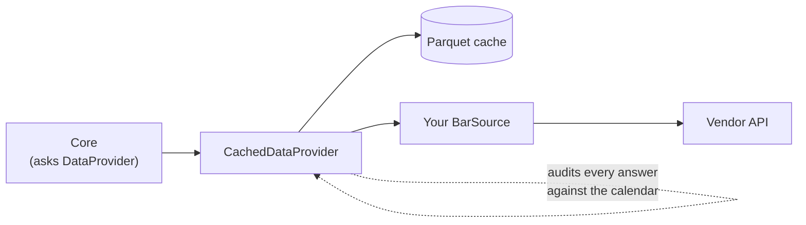

# How to add a data source

A data source is anything that can supply daily bars and corporate actions: Yahoo Finance today, IBKR or a paid vendor later. You add one by writing a `BarSource` adapter. The cache, the calendar audit and the `DataProvider` port stay exactly as they are.

The worked example throughout is `tyche.adapters.data.yfinance_source`.

## Where it fits

The core never sees your source. It asks the `DataProvider` port, and `CachedDataProvider` decides when to call you.

## The contract

Implement the `BarSource` protocol from `tyche.adapters.data.cached_provider`:

| Member | What to return |
|---|---|
| `name` | A short lower-case name, such as `yfinance`. It becomes the cache folder, so changing it later starts a fresh cache. |
| `adjustment` | A `PriceAdjustment` saying what your prices are adjusted for. Tyche expects `SPLITS` ([ADR-0019](../adr/0019-split-adjusted-prices-and-cash-dividends.md)). |
| `fetch_daily(instrument, first, last)` | A `SourceData` for sessions from `first` to `last` inclusive. |

`SourceData` holds four things:

- **`bars`**: one `Bar` per session, **stamped at that session's close in UTC**. Most vendors stamp daily bars at midnight; take the close from the `Calendar` instead (`calendar.session_on(day).closes_at`).
- **`distributions`**: a `CashDistribution` per dividend or capital-gain payment, dated on its ex-date, with an exact `Decimal` amount.
- **`splits`**: a `Split` per split, with its ratio as new shares per old share.
- **`issues`**: rows you could not turn into a bar, as `DataIssue`s. Use `OFF_SESSION` for a row on a day the market was closed and `INVALID_BAR` when `Bar` refuses the prices.

## Rules

1. **Never invent or repair data.** If a row is wrong, report it as an issue and leave it out. The audit decides what else is wrong ([ADR-0018](../adr/0018-audit-market-data.md)).
2. **Raise `DataError` for failures, return empty for "no data".** A weekend-only range, or a range before the security existed, is an empty `SourceData`, not an error.
3. **Retry only what is worth retrying.** Rate limits, server errors and dropped connections are temporary. An unknown symbol or a bad request will fail the same way every time, so fail at once.
4. **Keep the vendor library inside your module.** Only adapter code may import it; an import-linter contract checks this. Convert the vendor's objects to Tyche's types as soon as they arrive.
5. **Make the network call injectable.** `YFinanceSource` takes a `fetch` function and a `sleep` function, so its tests run without the network and without waiting.
6. **Write one opt-in network test** marked `@pytest.mark.network` that checks the facts your adapter relies on against the real service. Run it with `uv run pytest -m network`.
7. **Check the vendor's terms** and record them in the module docstring and in `STATUS.md`. Flag any cost before adding a paid source.

## Wiring it in

Sources are chosen in `tyche.runtime.data.fetch_daily_histories`. A second source would get its own option there. Each source has its own cache folder, so two sources never mix in one cache file.

## Checklist

- [ ] `BarSource` implemented, with bars stamped at session closes.
- [ ] Unit tests with a fake fetch: conversion, every error path, retries.
- [ ] One opt-in `network` test against the real service.
- [ ] If the library is untyped, a mypy override in `pyproject.toml`, agreed in the PR (`CLAUDE.md` rule 8).
- [ ] Terms of use and limits recorded.
- [ ] `STATUS.md` and `CHANGELOG.md` updated.
