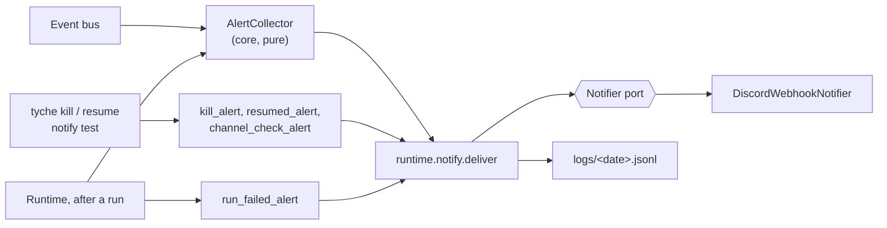

# How to add a notifier

A notifier delivers alerts to Pablo. Discord's webhook is the first ([ADR-0040](../adr/0040-logs-secrets-and-alerts.md)); email, a push service or a Discord bot would be others. This page shows how alerts are made and sent, and what a new channel has to do.

## How an alert travels

- **Alerts are values.** `Alert` (in `tyche.core.ports`) has a kind, a one-line title, a UTC time and lines of detail. Builders in `tyche.core.pipeline.alerts` make them from events or from a command's result. They are pure and tested without a network.
- **Which events alert is decided in one place,** `AlertCollector`: account triggers, the kill switch once per run, and a run's data problems as one alert. A new alert kind starts there, or as a new builder, with its tests.
- **Alerts leave after the run.** The collector only reads the bus. The runtime hands its alerts to `deliver` when the run has ended, so no network call happens inside a bus handler.
- **`deliver` never raises.** It sends each alert, logs every outcome, and returns a `Delivery` for the command to print.

## Writing a notifier

1. **Create the adapter** in `src/tyche/adapters/notifiers/<name>.py`: a class with `send(self, alert: Alert) -> None`. It does not inherit from the port.
2. **Raise `NotifierError` for every failure,** with a message a person can act on. Never put a secret (a URL with a token, an API key) in the message. Turn the transport's own exceptions into `NotifierError` with `from None`, so a traceback cannot carry the secret either.
3. **Respect the service's limits,** read from its current documentation, dated in the module docstring. Cut a message that is too long rather than failing. Wait for a rate limit only up to a bound.
4. **Inject what touches the world:** the HTTP call, `sleep` and the clock used for waits. Tests pass fakes. No test may reach the real service. The suite removes every `.env` key from the environment (`tests/conftest.py`).
5. **Add its secret to `.env`:** the key in `KNOWN_KEYS`, in `SECRET_KEYS` so logs hide it, a field on `Secrets`, and a line in both `.env.example` and `src/tyche/config/templates/env.example`, which stay identical.
6. **Build it in `tyche.runtime.notify.build_notifier`.** With more than one channel, return one that sends to each and gathers their failures.
7. **Document it** in the user guide's [Discord alerts, secrets and logs](../user-guide/09-discord-alerts-and-logs.md) page (or a sibling page), and in an ADR if the choice was significant.

## Testing

Copy the pattern of `tests/adapters/notifiers/test_discord.py`. A fake transport answers with scripted responses and records each request, and a fake clock records the waits. Cover the request itself, each failure status, a rate limit within and beyond the bound, an unreachable service, and a message over the length limit. Check in at least one test that the secret is in no error message.
