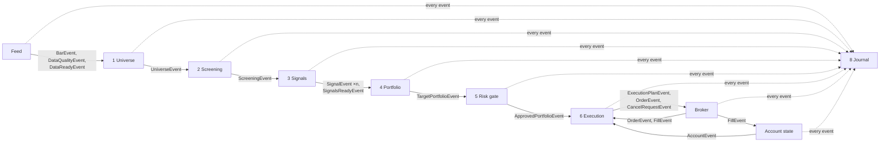

# Pipeline contracts

What each stage of the trading pipeline takes in, what it promises to put out, what it keeps between events, and what it does when something is wrong. As of the end of Phase 1. Field-level detail of every event is in the [event catalog](../architecture/event-catalog.md); how a backtest drives the stages is in [backtesting internals](backtesting-internals.md).

A stage is a subscriber on the event bus. It never calls another stage, and it never asks a data provider, a clock or a broker anything the events have not told it ([ADR-0003](../adr/0003-synchronous-event-bus.md), [ADR-0005](../adr/0005-backtest-paper-live-parity.md)). That is the whole of the contract between stages: the events below.

Stage 7, reconciliation, is not on the bus: it compares a checkpoint with the broker's record between runs (below).

## Two kinds of failure

Every stage separates them, and a reviewer should check that a new stage does too:

| Kind | Example | What happens |
|---|---|---|
| **The stage's inputs break an assumption.** A bug upstream or in the wiring | Bars out of order; a signal from another decision time; no account snapshot before a decision | The stage raises its own `…Error`. The bus halts for good, nothing queued is delivered, and the run reports the failure (fail closed, ADR-0003) |
| **A plugin misbehaves.** Its own fault, contained | A strategy raises, or returns weights adding up to more than 1 | Recorded in an event (`SignalsReadyEvent.failed`); that strategy's sleeve keeps what it holds; everything else goes on |

There is no third kind. A stage never logs a problem and carries on with a guess.

## Stage by stage

### 1. Universe (`tyche.core.pipeline.universe.UniverseStage`)

| | |
|---|---|
| Subscribes to | `BarEvent`, `DataQualityEvent`, `DataReadyEvent` |
| Publishes | One `UniverseEvent` per `DataReadyEvent` |
| Promises | Every instrument the feed expected appears exactly once, as eligible (with its last close and average dollar volume) or excluded with the first rule it failed: `not_in_profile`, `no_bar`, `data_issue`, `insufficient_history`, `price_too_low`, `illiquid` |
| Keeps | The last `liquidity_sessions` bars of each instrument, and how many more cycles each data issue keeps an instrument out |
| Halts on | A bar or a `DataReadyEvent` of a timeframe other than daily; inputs out of order (`UniverseError`) |
| Warm-up | `warm_up(histories)` before the first event, so the first decision is judged on the sessions before it |

### 2. Screening (`tyche.core.pipeline.screening.ScreeningStage`)

| | |
|---|---|
| Subscribes to | `UniverseEvent` |
| Publishes | One `ScreeningEvent` per `UniverseEvent` |
| Promises | Every eligible instrument either ranked (best score first, ties broken by symbol then exchange) or listed in `cut` below the limit. The same inputs always give the same ranking |
| Keeps | Nothing |
| A `Screen` must | Be deterministic and keep no state; it sees one `UniverseMember` at a time |
| Halts on | A score that cannot be ranked, such as `NaN` (`ScreeningError`) |

### 3. Signals (`tyche.core.pipeline.signals.SignalsStage`)

| | |
|---|---|
| Subscribes to | `BarEvent`, `ScreeningEvent` |
| Publishes | One `SignalEvent` per strategy that decided within the rules, then one `SignalsReadyEvent` naming who reported and who failed |
| Promises | Each strategy is handed a read-only `StrategyContext`: the ranking, exactly `lookback` bars per offered instrument, the instruments still warming up, and its own positions from the sleeve book ([ADR-0021](../adr/0021-strategies-see-a-window-handed-in.md)). Targets are checked: weights from 0 to 1 adding up to at most 1, only offered instruments, a stop below the last close |
| Keeps | A window of recent bars per instrument and timeframe |
| Records, does not halt, on | A strategy raising or breaking the contract (`StrategyContractError`) |
| Halts on | Bars out of order or on mixed price bases; a ranked instrument with no bar for the decision time (`SignalsError`) |
| Warm-up | `warm_up(histories)`, the one path that fills windows, used by backtests now and by paper and live at every start (Phase 2) |

### 4. Portfolio (`tyche.core.pipeline.portfolio.PortfolioStage`)

| | |
|---|---|
| Subscribes to | `SignalEvent`, `SignalsReadyEvent` |
| Publishes | One `TargetPortfolioEvent` per `SignalsReadyEvent`: a **proposed** portfolio |
| Promises | Weights of account equity, not shares ([ADR-0022](../adr/0022-portfolio-targets-as-weights-in-sleeves.md)). One `Sleeve` per strategy with a budget; per instrument, each strategy's `budget × weight` as a `Contribution` that keeps its own stop. "Keep what you hold" is said by the event itself, never by omission, so a restart cannot turn a hold into a sale |
| Keeps | Nothing between cycles |
| Halts on | A `SignalsReadyEvent` that does not match the budgets; a signal from another decision time (`PortfolioError`) |

### 5. Risk gate (`tyche.core.risk.RiskGate`)

| | |
|---|---|
| Subscribes to | `TargetPortfolioEvent`, and `AccountEvent` and `BarEvent` for the account snapshot and the last close |
| Publishes | At each `AccountEvent`: one `RiskEvent` per account rule that triggers. Per decision: one `RiskEvent` per cut, then one `ApprovedPortfolioEvent`: the **only** publisher of that type |
| Promises | Only lowers or removes contributions, never raises or adds one, and never touches what a sleeve keeps without deciding. Applies the daily loss limit (at the close it triggered: nothing entered or added to), then risk per trade (entries and additions with a stop), open positions (per sleeve, then the account) and position size (per sleeve, then per instrument across sleeves), in that order. Weights it sets are rounded down to `1e-12`. Every cut is listed in `adjustments` ([ADR-0033](../adr/0033-risk-gate-position-rules.md)). After the drawdown kill, every approval has no targets and carries `halt`, for the rest of the run ([ADR-0035](../adr/0035-account-rules-and-the-drawdown-halt.md)) |
| Keeps | The latest close of each instrument, the latest account snapshot, and `AccountRules`: the previous close's equity, the peak and the halt |
| Halts on | A decision with no account snapshot from the same close; a held instrument, or one entered with a stop, with no close seen (`RiskGateError`) |
| Never | Lets anything reach execution any other way. This is enforced by types: execution subscribes only to `ApprovedPortfolioEvent` ([ADR-0006](../adr/0006-target-positions-with-optional-stops.md)) |

### 6. Execution (`tyche.core.pipeline.execution.ExecutionStage`)

| | |
|---|---|
| Subscribes to | `ApprovedPortfolioEvent`, `AccountEvent`, `OrderEvent`, `FillEvent`, and `SessionEvent` and `BarEvent` for the session day and the last close |
| Publishes | Per decision: a `RiskEvent` for each purchase cut to the money caps, one `ExecutionPlanEvent`, then `CancelRequestEvent`s, then `OrderEvent`s (submitted): sales, then purchases, then stops to place again. After an entry fills: its protective stop |
| Promises | Whole shares only, rounded down; a holding within the rebalance band is kept; sleeves cross before anything is netted; one market order per instrument; purchases fit the buying power at the next open with the price buffer, costs included ([ADR-0023](../adr/0023-execution-sleeves-stops-and-cash.md)). With money caps (paper and live): weights sized on the lower of equity and the capital cap, and each purchase within the order cap and the capital cap, shrunk to the whole shares that fit; sales never cut ([ADR-0034](../adr/0034-order-level-guardrails.md)). Order ids derive from the decision, so the same decision gives the same ids and is handled once. A halted approval keeps everything and sends no order, not even a stop placed again (plan note `halted`) |
| Keeps | The sleeve book (each strategy's shares, shared with signals), the orders it created until they finish, and the decisions already handled |
| Halts on | No account snapshot for the decision's close; a market order still open at a decision (impossible in the simulator; live handling is a Phase 2 decision); a fill for an order it did not create; a sleeve book that no longer adds up to the account; sales and resting stops that would sell more than the account holds (long only); purchases costing more than the buying power (no leverage) (`ExecutionError`) |

### Account state (`tyche.core.pipeline.execution.AccountState`)

| | |
|---|---|
| Subscribes to | `SessionEvent`, `DistributionEvent`, `FillEvent`, `BarEvent` |
| Publishes | One `AccountEvent` at every session close, before that close's decision cycle |
| Promises | The same ledger rules as the broker's own record (`Account`), built only from the facts the broker reports, so that reconciliation has two independent records to compare |

### 7. Reconciliation (`tyche.core.pipeline.reconciliation`: `reconcile`, `correct`, `resolve`)

Pure functions, not a bus subscriber ([ADR-0044](../adr/0044-reconciliation-exact-positions-broker-cash.md)). The paper and live runs (PR 14) call them at startup, once the broker's fills are read, and after the run, each time on a checkpoint, and publish the result as a `ReconciliationEvent`.

| | |
|---|---|
| Reads | A `Checkpoint` (Tyche's account, the sleeve book, execution's working orders, reconciliation's memory) and a `BrokerRecord` from `Broker.record()`, the profile's `[reconciliation]` rules and its cash currencies |
| Returns | `reconcile`: a `Reconciliation` (differences, inferred fills, ended orders, a cash check per currency). `correct`: the checkpoint after it, corrected (broker's cash, ended orders dropped) or halted (the mismatch stored). `resolve`: the checkpoint with the halt lifted and what it explained applied, for `tyche resume` |
| Promises | Positions and orders exact; cash within the tolerance plus dividends on their way; a fill on a missed day is only ever explained, never applied without `tyche resume`; a backtest's own records always reconcile as a match with its `SimBroker` |
| Halts on | Nothing itself: a mismatch is stored in the checkpoint, the gate is built with it, and every approval carries it as `unreconciled`. `correct` and `resolve` raise `ReconciliationError` when a reconciliation names an order the checkpoint does not hold (a bug) |

### 8. Journal (`tyche.core.pipeline.journal`: `InMemoryJournal`, `StoredJournal`)

| | |
|---|---|
| Subscribes to | `Event`: everything |
| Promises | Every envelope in delivery order, with `seq`, `caused_by` and `cycle_id`, so any order can be traced back to the input that started its cycle (`JournalView.causes_of`) |
| `InMemoryJournal` | Keeps the run in memory. Backtests use it; their record is their run folder |
| `StoredJournal` | Appends each envelope to a `JournalStore` under its run id, committed before the next handler runs ([ADR-0037](../adr/0037-state-database-migrations-and-stored-journal.md)). Subscribed **first**, so a failing handler leaves the event it failed on stored. A refused envelope, or a `RunEvent` for another run, halts the bus. The paper cycle (PR 14) will use it |
| Reading back | `JournalView(store.read(run_id))` answers the same questions as the in-memory journal |

## Order of subscription

The bus delivers each event to its subscribers in the order they subscribed, so the wiring order is part of the contract. A backtest (`run_backtest` in `tyche.core.backtest.runner`) subscribes in pipeline order: universe, screening, signals, portfolio, the risk gate, account state, execution, the broker, and the journal last (it still receives everything). The order that matters is **account state before execution**: a `FillEvent` updates Tyche's account before execution splits it between sleeves, and each decision finds the `AccountEvent` of the same close. Paper and live will use the same wiring, with one difference: the `StoredJournal` subscribes **first**, so that every event is on disk before any stage acts on it.

## Adding or changing a stage

1. Decide which events it consumes and publishes. A new event, or a changed one, updates the [event catalog](../architecture/event-catalog.md) in the same PR.
2. Give it its own `…Error` for broken inputs, and decide what, if anything, is a plugin's fault to record instead.
3. Keep only what it was told. If it needs history, take it through a `warm_up` from the caller, never from a provider.
4. Test it with the bus and hand-made events, without the engine (see the stage tests under `tests/core/pipeline/`), then once through a backtest.
5. Update this page.
