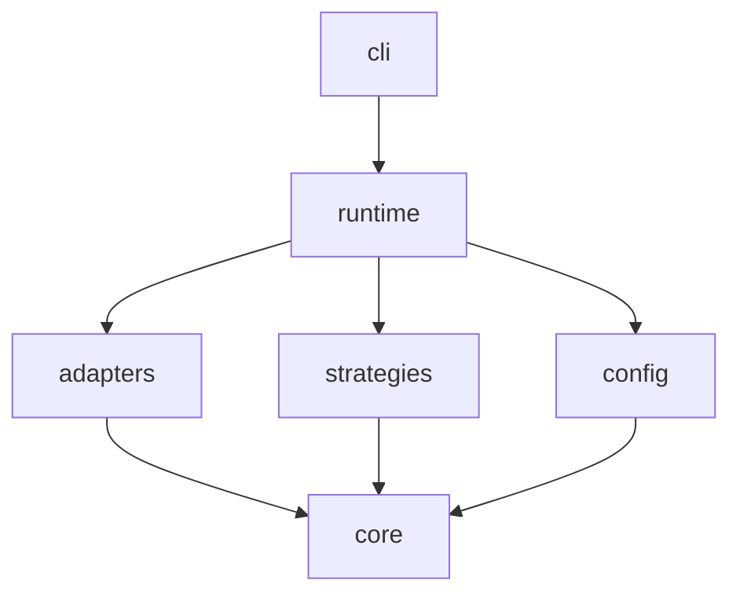

# Repo map

What every folder holds and which way imports are allowed to point. The reasoning is in [ADR-0004](../adr/0004-hexagonal-architecture.md).

## Top level

```text
Tyche/
├── CLAUDE.md             entry point for Claude Code sessions: rules, commands, map
├── STATUS.md             current phase, what works, what is next
├── CHANGELOG.md          notable changes per version
├── README.md             public introduction
├── pyproject.toml        project metadata, dependencies, tool config, architecture contracts
├── uv.lock               exact dependency versions (committed)
├── .python-version       Python pin read by uv, CI and (later) Docker
├── Makefile              shortcuts for the commands CI runs
├── .env.example          template for the workspace's .env; never holds real values
├── .github/workflows/    CI
├── src/tyche/            the package
├── tests/                tests, mirroring src/tyche
└── docs/                 all documentation
```

Your private config, data and state are not in this repository. They live in the workspace ([ADR-0008](../adr/0008-public-code-private-workspace.md)).

## The package

```text
src/tyche/
├── core/                 PURE: no I/O, no wall clock, no vendor imports
│   ├── domain/             value objects, the ledger, trading costs and share sizing
│   ├── events/             event types and the event bus
│   ├── ports/              interfaces to the outside world
│   ├── pipeline/
│   │   ├── universe/         stage 1: UniverseStage applies the profile's universe rules
│   │   ├── screening/        stage 2: ScreeningStage ranks the universe with a Screen
│   │   ├── signals/          stage 3: strategy interface and runner
│   │   ├── portfolio/        stage 4
│   │   ├── execution/        stage 6
│   │   ├── reconciliation/   stage 7
│   │   └── journal/          stage 8
│   ├── risk/               stage 5, plus profiles, guardrails and halts
│   ├── engine/             the run loop shared by all three modes
│   ├── sim/                SimClock, SimBroker, replay feed, settlement and fill models
│   ├── backtest/           runner, metrics, walk-forward, sweeps
│   ├── improvement/        proposals, gate, approvals, strategy lifecycle
│   └── agents/             offline LLM-agent workflows
├── strategies/           built-in strategy plugins (benchmark and examples)
├── adapters/             OUTSIDE WORLD: one folder per port
│   ├── data/               yfinance provider, Parquet cache
│   ├── brokers/            IBKR (later Kraken)
│   ├── calendars/          exchange calendars
│   ├── clocks/             wall clock
│   ├── notifiers/          Discord webhook
│   ├── llm/                claude-code (later ollama, anthropic-api)
│   ├── storage/            SQLite repositories
│   └── reports/            report rendering
├── config/               the workspace, config file schemas, loading, config hash
│   └── templates/          files `tyche init` copies into a new workspace
├── runtime/              composition root: chooses adapters and builds the engine
└── cli/                  the `tyche` command
```

Each package's `__init__.py` has a docstring saying what belongs there and which phase builds it.

## Where does new code go?

Ask these in order:

1. **Does it talk to a network, the disk, the wall clock or a vendor library?** It is an adapter: `tyche.adapters.<port>`.
2. **Is it a trading strategy?** `tyche.strategies` (built in) or your workspace's `strategies/` folder.
3. **Does it choose which implementation to use, or start things up?** `tyche.runtime`.
4. **Is it a user-facing command?** `tyche.cli`.
5. **Otherwise** it is pure logic and belongs in `tyche.core`, in the package for its concern.

If a piece of core code needs something from the outside world, it does not import it. It declares what it needs as a port in `tyche.core.ports`, and an adapter provides it.

## Dependency rules

Arrows mean "may import".



Inside the core, higher rows may import lower rows, never the reverse:

| Layer | Packages |
|---|---|
| 1 (top) | `agents` |
| 2 | `improvement` |
| 3 | `backtest` |
| 4 | `engine`, `sim` |
| 5 | `pipeline`, `risk` |
| 6 | `ports` |
| 7 | `events` |
| 8 (bottom) | `domain` |

Packages on the same row do not import each other. For example, the pipeline stages and the risk gate never call each other; the engine connects them through the bus.

### The contracts CI checks

Defined in `pyproject.toml` under `[tool.importlinter]`, run with `make imports`.

| Contract | What it prevents |
|---|---|
| Outer layers depend inward | The core importing an adapter, the runtime or the CLI |
| Inside the core, dependencies point toward the domain | Low-level packages reaching up, and cycles |
| The core never imports a vendor or I/O library | `ib_async`, `yfinance`, `httpx`, `sqlite3`, `subprocess` and others leaking into pure code |
| No LLM code in the trading path | Pipeline, risk, engine, simulator or strategies importing agent or LLM code |
| Strategies cannot reach risk, execution, the engine or any port | A strategy adjusting its own limits or talking to a broker |

When a contract fails, the fix is almost always to move the code or add a port, not to edit the contract. Changing a contract needs Pablo's agreement in the PR.

## Tests

`tests/` mirrors `src/tyche/`: the tests for `tyche/core/risk/` live in `tests/core/risk/`. Test categories are described in [conventions](conventions.md#testing).
