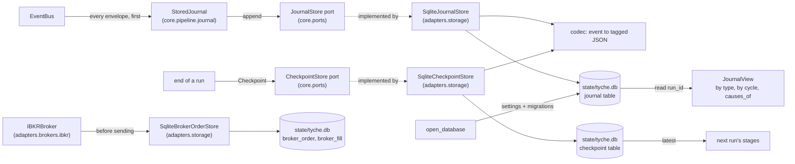

# The state database

Tyche's operational state lives in one SQLite file, `state/tyche.db` in the workspace ([ADR-0009](../adr/0009-storage-sqlite-parquet.md), [ADR-0037](../adr/0037-state-database-migrations-and-stored-journal.md)). It holds the journal, the checkpoint each run hands to the next ([ADR-0038](../adr/0038-checkpoints-across-restarts.md)), and the broker adapter's record of what it sent ([ADR-0042](../adr/0042-ibkr-paper-adapter-at-most-once-orders.md)).

## How it fits together



The core knows only the `JournalStore` and `CheckpointStore` ports and the `StoredJournal` subscriber; it never imports `sqlite3` (an import-linter contract checks this). Everything that touches the file is in `tyche.adapters.storage`.

## Opening it

```python
from contextlib import closing
from tyche.adapters.storage import SqliteJournalStore, open_database

with closing(open_database(workspace.state_database)) as connection:
    store = SqliteJournalStore(connection)
    StoredJournal(bus, store, run_id)  # subscribe it before any other stage
```

`open_database` creates the folder and the file if needed, turns on foreign keys, write-ahead logging and `synchronous = FULL`, applies any migration the file has not seen, and returns a connection with `autocommit=False`. Close it when done: closing rolls back anything not committed. The journal store commits every envelope itself.

## The journal table

| Column | Holds |
|---|---|
| `run_id`, `seq` | The key. Every run's bus numbers its envelopes from 1 |
| `occurred_at` | The clock's time at publication, ISO 8601 UTC |
| `source` | The component that published it |
| `event_type` | The event's class name, checked against the payload when read |
| `caused_by` | The `seq` of the cause in the same run, or empty for an outside input. A foreign key: the cause must already be stored |
| `cycle_id` | The decision cycle, if any |
| `format` | The codec's format number (1) |
| `payload` | The event as tagged JSON |

Triggers refuse every update and delete. To look at a database by hand, open it read-only: `sqlite3 -readonly state/tyche.db`.

## The checkpoint table

What a run leaves for the next one: Tyche's account view, the sleeve book, execution's working orders and wanted stops, and the account rules' memory (the previous close, the peak and any halt). One row per run, taken when the run completes; a run that fails leaves none, and the next run carries on from the last good one ([ADR-0038](../adr/0038-checkpoints-across-restarts.md)).

| Column | Holds |
|---|---|
| `number` | The order saved. The latest checkpoint is the highest |
| `run_id` | The run that ended in this state. Unique: a run saves one checkpoint |
| `first_seq` | Always 1. With `run_id`, a foreign key to the run's first journal envelope: a run with no stored journal cannot save a checkpoint |
| `saved_at` | When it was taken, ISO 8601 UTC. Must be later than the latest |
| `format` | The codec's format number (1) |
| `payload` | The `Checkpoint` as tagged JSON |

Triggers refuse every update and delete. Reading a checkpoint rebuilds it through its constructor, which checks that its parts agree (the sleeves add up to the account, every resting stop is a working stop order of its sleeve), so a stored checkpoint that does not add up is refused, not loaded.

```python
from tyche.adapters.storage import SqliteCheckpointStore

store = SqliteCheckpointStore(connection)
start = store.latest()  # None before the first run
# ... build the stages from start, warm up, run, then:
store.save(checkpoint)  # after the run's journal is stored
```

**A manual restart is a run too.** `tyche resume` ([ADR-0039](../adr/0039-kill-switch-and-manual-restart.md)) stores a run named `resume-<time>` with one envelope, a `ResumeEvent` (source `cli`). If the latest checkpoint carries a drawdown halt, the same run saves a checkpoint with the same account, sleeves and orders, and the rules from `AccountRulesState.resumed()`: no halt and no peak. So the chain of checkpoints stays the one record of state, and the journal says who lifted the halt and why. Its `saved_at` is the wall clock, and must be later than the latest checkpoint's: `tyche resume` checks that before it writes anything.

## The broker order tables

Migration `0003_broker_order.sql`. What `IBKRBroker` sent, written and committed **before** it is sent, so a crash or a lost connection never leaves an order Tyche may have sent but has no record of ([ADR-0042](../adr/0042-ibkr-paper-adapter-at-most-once-orders.md)). `SqliteBrokerOrderStore` reads and writes them.

`broker_order`, one row per order, changed as the order moves:

| Column | Meaning |
|---|---|
| `client_order_id` | Tyche's id, also sent as IBKR's `orderRef`. A primary key: an id in this table is never sent again |
| `sent_at` | When it was written, just before sending |
| `fate` | `sending` (written, not confirmed), `placed` (IBKR gave it an id or listed it), `lost` (not found at IBKR after a reconnection; rejected, never resent). Moves only forward |
| `order_id`, `perm_id` | IBKR's API order id and permanent id, once known |
| `cancel_requested` | Tyche asked for it to be cancelled; `sync` asks again while it still works |
| `format`, `state` | The latest `OrderState` Tyche published for it, as the codec writes it |
| `updated_at` | The last change |

`broker_fill`, append-only (triggers refuse updates and deletes): every IBKR execution already published as a `FillEvent`, so the same day's executions, read again by a later run, are not applied twice. Each row names its order, a foreign key to `broker_order`.

A row is changed only after the event it records has been delivered: if the run fails first, it saves no checkpoint, and the next run must see the event again.

## Adding a migration

1. Add `src/tyche/adapters/storage/migrations/NNNN_what_it_does.sql`, numbered one past the last file.
2. Write plain SQL: `CREATE`, `ALTER`, `INSERT`. No `BEGIN`, `COMMIT` or `PRAGMA`: the runner wraps the file in one transaction with its version bump. Trigger bodies may use `BEGIN … END`.
3. Never edit, rename or renumber a file that has been merged. A workspace may already have run it, and would never run it again.
4. Test it in `tests/adapters/storage/`: from an empty file, and from a database at the previous version with rows in it.

There are no down-migrations. To undo a change, write a new migration that reverses it.

## Changing a stored event or checkpoint

The journal's rows are never rewritten, so every event ever stored must stay readable.

- **Adding a field with a default** to an event or a value object it carries is compatible: old rows read back with the default.
- **Anything else** (renaming a class or field, removing a field, changing a field's meaning or type) needs a new `codec.FORMAT` and a reader that still reads the old format. Write an ADR for it.
- The same holds for every part of a `Checkpoint`: its classes are value objects in `tyche.core.domain`, read back through their constructors.
- Adding memory to a stage means adding it to that stage's part of the checkpoint. `tests/integration/test_restart.py` fails first if a part is forgotten: a backtest cut in two and carried on from its checkpoint must equal one run straight through.
- A new event or value object must be exported from `tyche.core.events` or `tyche.core.domain`, or the codec refuses it. `tests/adapters/storage/test_codec.py` checks every exported event type is storable, and `tests/integration/test_journal_round_trip.py` checks that real runs, plus samples of the rare events in `tests/support/events.py`, read back identical. A new event type that a short backtest does not publish needs a sample there.
