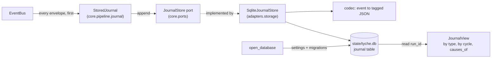

# The state database

Tyche's operational state lives in one SQLite file, `state/tyche.db` in the workspace ([ADR-0009](../adr/0009-storage-sqlite-parquet.md), [ADR-0037](../adr/0037-state-database-migrations-and-stored-journal.md)). Today it holds the journal. PR 7 adds what a paper run needs across restarts.

## How it fits together



The core knows only the `JournalStore` port and the `StoredJournal` subscriber; it never imports `sqlite3` (an import-linter contract checks this). Everything that touches the file is in `tyche.adapters.storage`.

## Opening it

```python
from contextlib import closing
from tyche.adapters.storage import SqliteJournalStore, open_database

with closing(open_database(workspace.state_database)) as connection:
    store = SqliteJournalStore(connection)
    StoredJournal(bus, store, run_id)  # subscribe it before any other stage
```

`open_database` creates the folder and the file if needed, turns on foreign keys, write-ahead logging and `synchronous = FULL`, applies any migration the file has not seen, and returns a connection with `autocommit=False`. Close it when done: closing rolls back anything not committed. The journal store commits every envelope itself.

## The journal table

| Column | Holds |
|---|---|
| `run_id`, `seq` | The key. Every run's bus numbers its envelopes from 1 |
| `occurred_at` | The clock's time at publication, ISO 8601 UTC |
| `source` | The component that published it |
| `event_type` | The event's class name, checked against the payload when read |
| `caused_by` | The `seq` of the cause in the same run, or empty for an outside input. A foreign key: the cause must already be stored |
| `cycle_id` | The decision cycle, if any |
| `format` | The codec's format number (1) |
| `payload` | The event as tagged JSON |

Triggers refuse every update and delete. To look at a database by hand, open it read-only: `sqlite3 -readonly state/tyche.db`.

## Adding a migration

1. Add `src/tyche/adapters/storage/migrations/NNNN_what_it_does.sql`, numbered one past the last file.
2. Write plain SQL: `CREATE`, `ALTER`, `INSERT`. No `BEGIN`, `COMMIT` or `PRAGMA`: the runner wraps the file in one transaction with its version bump. Trigger bodies may use `BEGIN … END`.
3. Never edit, rename or renumber a file that has been merged. A workspace may already have run it, and would never run it again.
4. Test it in `tests/adapters/storage/`: from an empty file, and from a database at the previous version with rows in it.

There are no down-migrations. To undo a change, write a new migration that reverses it.

## Changing a stored event

The journal's rows are never rewritten, so every event ever stored must stay readable.

- **Adding a field with a default** to an event or a value object it carries is compatible: old rows read back with the default.
- **Anything else** (renaming a class or field, removing a field, changing a field's meaning or type) needs a new `codec.FORMAT` and a reader that still reads the old format. Write an ADR for it.
- A new event or value object must be exported from `tyche.core.events` or `tyche.core.domain`, or the codec refuses it. `tests/adapters/storage/test_codec.py` checks every exported event type is storable, and `tests/integration/test_journal_round_trip.py` checks that real runs, plus samples of the rare events in `tests/support/events.py`, read back identical. A new event type that a short backtest does not publish needs a sample there.
