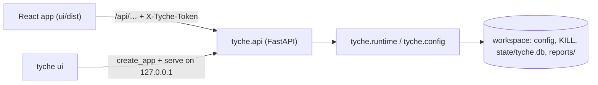

# The console: how it is built

The console ([ADR-0046](../adr/0046-a-local-web-console.md)) is two parts served by one command:



## Where things go

| Change | Files |
|---|---|
| New data for a page | A model in `src/tyche/api/models.py`, a reader beside `status.py` (one module per page), a route in `app.py`. Then `make ui-types` |
| A new page | `ui/src/features/<name>/`: the page, its parts, a `use<Name>.ts` query hook. Add it to `ui/src/app/navigation.ts` and to the routes in `ui/src/app/App.tsx` |
| A call to the API | A method in `ui/src/api/client.ts`, typed with the names in `ui/src/api/types.ts` |
| Shared look | `ui/src/components/` (cards, alerts), `ui/src/lib/format.ts` (money, percent, dates), `ui/src/app/theme.ts` |

Rules:

- **The API only reads, or runs `tyche` as a subprocess** (from U2). It never calls the broker, the risk gate or anything a command does not: a page cannot do what the CLI cannot.
- **Every `/api` route sits behind the token.** Add routes to the `api` router in `create_app`, never to `app` directly.
- **Secrets never leave the server.** Models carry whether a secret is set, never its value; a test checks the webhook is not in the response.
- **Only `tyche.api` imports FastAPI, Starlette or uvicorn** (an import contract).
- **Money and fractions are strings** in the API, formatted in `lib/format.ts`.

## The type contract

`tyche.api.models` is the contract. `make ui-types` writes its OpenAPI schema to `ui/src/api/openapi.json` and generates `ui/src/api/schema.d.ts` from it. Commit both. `tests/api/test_app.py` fails when the committed schema no longer matches the API, and `npm run typecheck` fails when the app uses a field that is gone.

## Working on the page

```bash
uv run tyche ui --home <scratch-workspace> --no-browser   # the API, on 127.0.0.1:8765
cd ui && npm run dev                                        # the page with hot reload, on 127.0.0.1:5173
```

Open `http://127.0.0.1:5173/#token=…` with the token the first command printed; Vite passes `/api` to the console. Never point a development console at Pablo's workspace.

## Checks

`make check` runs the app's type check and lint (`make ui-check`) after the Python checks; CI runs the type check, lint and build in its own job. Versions in `ui/package.json` are exact, and `ui/package-lock.json` is committed: update a package on purpose, in its own PR, after reading its changelog and licence.
