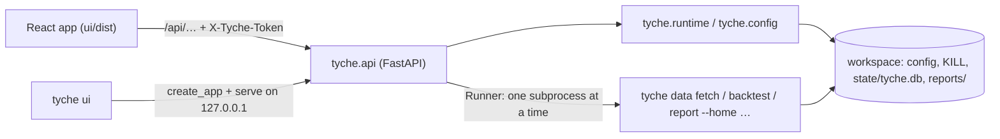

# The console: how it is built

The console ([ADR-0046](../adr/0046-a-local-web-console.md)) is two parts served by one command:



## Where things go

| Change | Files |
|---|---|
| New data for a page | A model in `src/tyche/api/models.py`, a reader beside `status.py` (one module per page), a route in `app.py`. Then `make ui-types` |
| A new page | `ui/src/features/<name>/`: the page, its parts, a `use<Name>.ts` query hook. Add it to `ui/src/app/navigation.ts` and to the routes in `ui/src/app/App.tsx` |
| A call to the API | A method in `ui/src/api/client.ts`, typed with the names in `ui/src/api/types.ts` |
| A command the page can run | See *Running a command* below |
| Shared look | `ui/src/components/` (cards, alerts), `ui/src/lib/format.ts` (money, percent, dates), `ui/src/app/theme.ts` |

Rules:

- **The API only reads, or runs `tyche` as a subprocess** (`tyche.api.runs`). It never calls the broker, the risk gate or anything a command does not: a page cannot do what the CLI cannot.
- **Every `/api` route sits behind the token.** Add routes to the `api` router in `create_app`, never to `app` directly.
- **Secrets never leave the server.** Models carry whether a secret is set, never its value; a test checks the webhook is not in the response.
- **Only `tyche.api` imports FastAPI, Starlette or uvicorn** (an import contract).
- **Money and fractions are strings** in the API, formatted in `lib/format.ts`.

## Running a command

A run is the CLI itself: `Runner.start` starts `python -m tyche <arguments> --home <workspace>` with the console's environment and `PYTHONUNBUFFERED=1`, reads its output and error streams line by line on two threads, and keeps them with the run. One run at a time: a second gets `RunBusyError`, which the route answers with 409. The last run stays in memory until the next one starts; what it wrote is in the workspace.

The page sends a typed request, never a command line ([a second front door](../learning/a-second-front-door.md)). To let it run another command:

1. A request model in `models.py`, deriving `_Request` (a field the command lacks is refused), with a `command` literal and a pattern on every free-text value so none can start with `-`. Add it to `RunRequest`.
2. A `case` in `tyche.api.runs.arguments` that builds the arguments as a terminal would.
3. Tests in `tests/api/test_runs.py`: the arguments, and the request with an option-like value refused (422) before a process starts.
4. `make ui-types`, then a form in its feature folder that calls `useStartRun()` and shows `<LastRun run={useCurrentRun().data} />`.

**The paper cycle, `kill` and `resume`** (U3) also carry `confirmed: Literal[True]` in their request, so the contract itself says the page asked first, and `kill` and `resume` run with `--yes`, the answer to their own question. A reason is free text, so it goes as one `--reason=<text>` argument: nothing in it can read as an option. Their tests never start the real `tyche paper run` (it connects to IB Gateway); `kill` and `resume` run for real on a temporary workspace with an empty environment.

**Alerts are read from the logs** (`tyche.api.paper`): every alert is written to `logs/<day>.jsonl` as it is sent or not, already redacted (ADR-0040), and that is the only record of them. **Reconciliations** are the `ReconciliationEvent`s of the last cycle's two journal runs (`paper-<time>-check` and `paper-<time>`).

**Live output is polled, not streamed.** `GET /api/runs/current` returns the run with all its lines; `useCurrentRun` asks again every 0.7 s while the state is `running`, and stops when it ends. A plain GET carries the token header like every other call (an `EventSource` cannot set headers), and a run prints tens or hundreds of lines, so sending them all each time is cheap. When a run ends, the page reads the records and the status again.

Tests start a stand-in program (`create_app(..., program=...)`) to check the runner alone, and the real `tyche backtest` on a workspace with a cache to check it end to end. `app.state.runner.wait()` waits for a run to end.

**Reports are shown in a sandboxed frame** (`ReportPage.tsx`). The page fetches `report.html` with the token and shows it from a `blob:` address with `sandbox="allow-same-origin"` and no `allow-scripts`: nothing in it can run, so same-origin gives it no reach. Not `srcdoc`: a `srcdoc` document resolves `#section` links against the console's address, so the report's table of contents would load the console inside the frame.

## The type contract

`tyche.api.models` is the contract. `make ui-types` writes its OpenAPI schema to `ui/src/api/openapi.json` and generates `ui/src/api/schema.d.ts` from it. Commit both. `tests/api/test_app.py` fails when the committed schema no longer matches the API, and `npm run typecheck` fails when the app uses a field that is gone.

## Working on the page

```bash
uv run tyche ui --home <scratch-workspace> --no-browser   # the API, on 127.0.0.1:8765
cd ui && npm run dev                                        # the page with hot reload, on 127.0.0.1:5173
```

Open `http://127.0.0.1:5173/#token=…` with the token the first command printed; Vite passes `/api` to the console. Never point a development console at Pablo's workspace.

## Checks

`make check` runs the app's type check and lint (`make ui-check`) after the Python checks; CI runs the type check, lint and build in its own job. Versions in `ui/package.json` are exact, and `ui/package-lock.json` is committed: update a package on purpose, in its own PR, after reading its changelog and licence.
