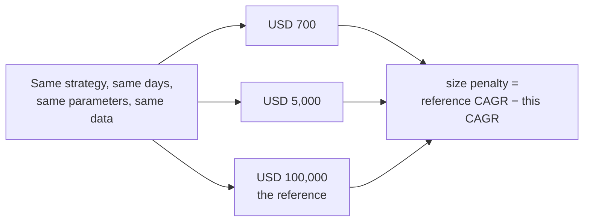

# What account size costs

**The idea in one line:** run the same strategy on a large account and on yours, change nothing else, and read the difference as the price of being small.

## The problem

A backtest at USD 10,000 says little about a USD 700 account. Two things change with size, and neither is visible in a strategy's rules:

- **Fixed costs per order.** IBKR Pro Fixed charges at least USD 1.00 an order. On a USD 10,000 position that is 0.01%; on a USD 140 position it is 0.7%, each way.
- **Whole shares.** Tyche can only hold whole shares ([ADR-0020](../adr/0020-cost-and-settlement-model.md)). A target of USD 140 in an ETF priced at USD 600 is zero shares. The strategy decided to hold it; the account cannot.

Both shrink as the account grows. So the question "how much capital does this strategy need?" has an experimental answer: find where they stop mattering.

## The pattern: a controlled comparison

Change **one** input, keep everything else fixed, and compare against a **reference** where that input no longer matters.

On the reference account the minimum commission is a rounding error and whole shares leave almost nothing in cash, so its result is "the strategy itself". The **size penalty** of a smaller amount is how much of that result its size takes away.

This is the same idea as a control group in an experiment. A run with no reference only says how a strategy did at a size. It cannot separate what the strategy did from what the size did to it.

## A reference can be too large

"Large" has a limit. Tyche's simulator fills at most 1% of a bar's volume, as a crude stand-in for what a big order does to the market. Tyche's first choice of reference, USD 1,000,000, was too big for the trend rotation: each of its three positions was about USD 333,000, and in 2005 some of these ETFs traded little enough that 22 of its orders were cut short. The rotation then did *better* at USD 25,000 and 100,000 than on its own reference, and no size looked viable.

So the reference has to be large enough that costs and whole shares do not matter, and small enough that the market's capacity does not either. Tyche now uses USD 100,000, where no order of any example strategy was cut short, and flags any reference run with an order cut short.

## Within the tolerance, either way

An amount is viable when its CAGR is within a tolerance of the reference's (Tyche's default: half a point a year). Note **either way**. Running `tyche capital` on SPY over 2020 and 2021 showed why:

- USD 300 could not buy one share of SPY at about USD 320.
- In March 2020 SPY fell below USD 300, the account bought one share, and rode the recovery fully invested.
- Its CAGR beat the large account's by almost 7 points a year.

That is not a strategy working well. It is a different strategy: "wait in cash until a crash makes a share affordable". It happened once, by luck. A result that size changes a lot in *either* direction means the strategy you designed is not the one the account runs.

## Smallest from which all larger work

The minimum viable capital is the smallest tested amount from which **every larger tested amount** is viable. One lucky amount below a failing one does not count. Without this, a noisy result at a small size could be read as "this works at USD 500" when USD 1,000 and USD 2,000 do not.

## What it does not tell you

The size penalty says what account size costs. It says nothing about whether the strategy is worth running. A strategy that trails the benchmark on a USD 100,000 account has no edge for its small-account version to keep, whatever its size penalty. Tyche reports both, side by side, and keeps them apart.

## Where it is in Tyche

- `tyche.core.backtest.capital`: `size_penalty`, `is_viable`, `minimum_viable`, `round_trip_cost`.
- `tyche.runtime.capital`: runs each strategy alone at every amount and plan.
- [ADR-0031](../adr/0031-minimum-viable-capital.md) and the user guide's [minimum viable capital](../user-guide/06-minimum-viable-capital.md).
