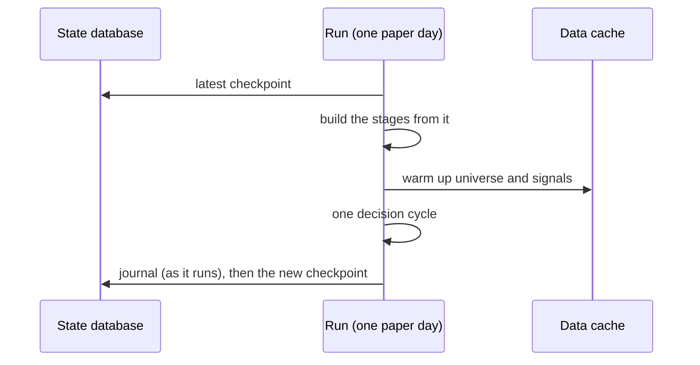

# Checkpoints

## The problem

A backtest runs from its first day to its last in one process. Paper trading does not: Tyche starts after each close, makes one decision, sends orders for the next open, and stops. Tomorrow a new process starts. It must know what yesterday's process knew: which shares belong to which strategy, which orders are still working and whom they are for, the highest equity ever reached, and whether the drawdown kill has halted trading.

Lose any of these and the restarted run is wrong in a way no test of a single run would catch. A forgotten halt resumes trading after a 15% loss. A forgotten working order means its fill tomorrow belongs to nobody, and execution halts. A forgotten peak quietly resets the drawdown kill to zero.

## The idea

Split the memory in two, by where it comes from.

- **What the market says** (recent bars, data problems) can be rebuilt from history at every start. That is the [warm-up](state-built-from-events.md), and it is the same in every mode.
- **What Tyche did** (orders, fills, crossings, the peak, a halt) cannot. The market does not know which sleeve owns a share. That part is saved when a run ends, as one **checkpoint**, and the next run starts from it.

Three rules make a checkpoint trustworthy:

1. **Save it whole, and check it.** The parts are saved together, in one row and one transaction, and the checkpoint refuses to exist if they disagree: the sleeves must add up to the account, every resting stop must be a working order. A bad checkpoint fails when it is read, before it can trade.
2. **Save only at a quiet moment.** At the end of a run that completed, between sessions. A run that fails saves nothing; the next run starts from the last good checkpoint, and reconciliation explains whatever the failed run left at the broker.
3. **Prove it by cutting a run in two.** Run a backtest straight through. Run it again up to some day, take the checkpoint, and carry on from it with every stage built anew. If any part of the memory was forgotten, the two disagree somewhere: a fill, a close, an order. The test cuts at the awkward moments: orders still working, stops resting, just before and just after a halt.

## The alternative: replaying the log

The journal already stores every event. Feeding them all back through the stages would rebuild the memory with no second copy (this is called *event sourcing*). It is a good fit where the code that interprets events never changes. Here it does: a fix to execution would re-interpret two years of old fills, and the rebuilt past, and so the present, would quietly change. Replays also grow with every day traded. Tyche keeps the journal as the *evidence* for each checkpoint, not as its source.

## Where it is in Tyche

- `tyche.core.domain.checkpoint`: `Checkpoint` and its parts, with the checks.
- `SleeveBook.state()`, `ExecutionStage.state()`, `AccountRules.state()` export each part; each takes it back when built (`start=`, `rules=`).
- `tyche.adapters.storage.checkpoint`: `SqliteCheckpointStore`, one append-only row per run, tied to that run's stored journal ([ADR-0038](../adr/0038-checkpoints-across-restarts.md)).
- `tests/integration/test_restart.py`: the cut-in-two test.

## What it costs

- **Every new piece of memory must join the checkpoint.** A stage that starts remembering something must export it and accept it back. The cut-in-two test catches a part that was forgotten, but only if the scenario exercises it.
- **Changing a part is a stored-format change**, with the same rule as the journal: adding a field with a default is free; anything else needs a new format number and a reader for the old one ([schema migrations](schema-migrations.md)).
- **The broker is the other half.** A checkpoint is Tyche's own record. The broker keeps its own, and the two are compared at every start (reconciliation, Phase 2, PR 13). In tests the simulator stands in for the broker and carries its own state across the cut.
