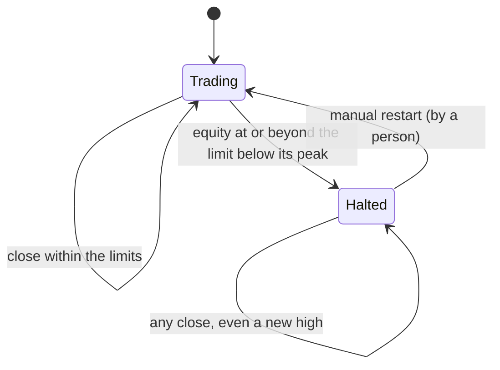

# Circuit breakers and latches

## The problem

Most risk rules look at one decision: is this position too big, does this stop risk too much? Some dangers only show across many decisions. A strategy can make a sequence of trades that are each within every limit and still lose a third of the account over a few weeks. Something has to watch the account as a whole and, past a point, stop trading altogether.

Two questions make that harder than it sounds. **When does it stop?** If the rule stops trading only while the account is down, it starts again the moment prices bounce, which is often just before the next fall. **Who lets it start again?** If code can resume trading by itself, the stop is only a pause, and the conditions that tripped it may still be there.

## The idea

Borrow two ideas from electrical engineering.

- A **circuit breaker** watches one measure and trips when it crosses a limit. It does not judge individual trades; it cuts the whole circuit.
- A **latch** remembers that it tripped. Once set, it stays set whatever happens next, until something outside the system resets it.

Together: a breaker that, once tripped, stays tripped until a person resets it.

A softer cousin is a **one-shot block**: it trips for one cycle and resets by itself on the next. It suits a rule meant to slow things down rather than stop them.

## Where it is in Tyche

Both kinds are in the risk gate ([ADR-0035](../adr/0035-account-rules-and-the-drawdown-halt.md)). `AccountRules` (in `tyche.core.risk.account`) measures the account's equity at every session close:

- the **daily loss limit** is the one-shot block. A close that lost at least the limit since the previous one blocks entries and additions at that close only ([ADR-0015](../adr/0015-daily-loss-limit.md));
- the **drawdown kill** is the latched breaker. A close at least the limit below the highest close so far sets `halt`, and nothing in `AccountRules` ever clears it. From then on `RiskGate` approves every proposal with nothing in it and the halt attached, and execution keeps every holding and sends no order. Resetting it is a person's act: `tyche resume` ([ADR-0039](../adr/0039-kill-switch-and-manual-restart.md)).

`AccountRules` holds only the state the rules need (the previous close, the peak, the halt) and has no bus, so its tests are a few lines each ([functional core](functional-core.md)). `tests/core/risk/test_account.py` checks the latch directly: after the halt, a close at twice the peak still returns nothing and leaves the halt in place.

The halt travels on the `ApprovedPortfolioEvent` itself rather than as a flag execution has to look up. The one event execution acts on stays the whole truth about what may be traded.

## A breaker a person trips: the kill switch

The kill switch ([ADR-0039](../adr/0039-kill-switch-and-manual-restart.md)) is the same breaker, tripped by hand. It is a file, `KILL` in the workspace, and the risk gate reads it at every decision through the `KillSwitch` port. While it is there, the gate approves nothing and carries the switch on the approval, as it carries the halt.

Three choices make it trustworthy:

- **It fails closed.** A file that cannot be read, or says something unexpected, still engages the switch, but never with flatten. When in doubt, stop buying. Never sell everything because of a typo.
- **It is easier to trip than to reset.** `touch KILL` trips it with no command and no database. Resetting takes `tyche resume`, which shows what it lifts, asks, and records why.
- **The reset is deliberate about what it forgets.** Lifting the drawdown halt also forgets the peak, so the next close becomes the new peak. Keeping the old peak would trip the breaker again at once, because the account is still down. Forgetting it gives the account a fresh drawdown budget, which is exactly why each reset is a person's decision, written in the journal.

## What it costs

- **It can stop you at the bottom.** A drawdown limit trips after the fall, often near its low. Holding through, or selling, at that point may be the worst choice in hindsight. A backtest shows the cost and the benefit together. Tyche's example rotation halted in March 2020, held its funds untouched through the recovery and ended higher, but its worst fall later grew from 15% to 20%. Neither is evidence about the strategy.
- **A backtest cannot model the reset.** When a person would restart is a judgement, not a rule. Tyche's backtests run on without trading after a halt, which shows what happens if nobody restarts, and say so in the report. Any other choice would be inventing a decision.
- **A switch a person trips is slow in an end-of-day system.** The gate reads it at the next decision, after the next close, so orders already sent for the next open still fill. That is the price of having one path to the broker. The [runbook](../runbooks/kill-switch.md) shows how to cancel them by hand.
- **It must be stored.** A latch that forgets on restart is not a latch. The halt is part of every run's [checkpoint](checkpoints.md) (Phase 2, PR 7), so a restart from it stays halted; only `tyche resume` lifts it, as a run of its own that saves a new checkpoint. Nothing is edited.
