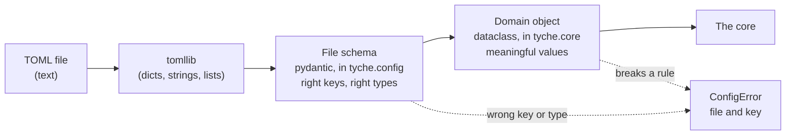

# Config at the boundary

## The problem

Configuration is input from a human, typed into a text file. It is the least trustworthy data a program reads, and in a trading system it decides how much money moves. Three things commonly go wrong:

- **A typo is silently ignored.** `risk_profle = "safecash"` (missing an `i`) is read, ignored, and the system runs on the default profile. Nothing fails; the wrong thing happens.
- **A value is quietly converted.** `max_positions = "5"` becomes `5` in some places and stays a string in others. `true` becomes `1`.
- **A bad value is found late.** The config loads fine at startup, and the problem only shows up when some deep piece of code finally reads the key, perhaps mid-run.

## The idea

Check all of the configuration once, at the moment it enters the program, and turn it into types that cannot be wrong. Past that point, nothing re-checks it. This is often summed up as **parse, don't validate**: rather than checking a dictionary and carrying the dictionary around, convert it into a value whose type proves it was checked.

Tyche does it in two layers:

1. **The file schema** answers "is this shaped right?": only known keys, each with the right type, no quiet conversions.
2. **The domain object** answers "does this make sense?": a market profile needs at least one calendar, and no calendar may appear twice.

The core only ever sees the domain object. It never imports pydantic and never sees a raw dictionary ([ADR-0017](../adr/0017-config-schemas-at-the-boundary.md)).

If you have used a schema library such as Zod in TypeScript to parse an API response, this is the same move: parse at the edge, then trust the typed result everywhere inside.

### The config hash

Once the configuration is parsed, Tyche computes a fingerprint of it: a SHA-256 hash of the parsed values, written in a fixed order. Every run will record this hash beside its results.

Hashing the *values* rather than the file text is deliberate. Reformatting a file, reordering keys or editing a comment does not change the hash; changing any setting does. So two results with the same hash were produced by the same configuration, and a different hash tells you to look for what changed. Secrets in `.env` are never part of it.

## Where it is in Tyche

- File schemas, loading and the hash: `tyche.config.loader`.
- The workspace that holds the files: `tyche.config.workspace`.
- The domain object for market profiles: `tyche.core.domain.market_profile`.
- The command that runs it all and shows the hash: `tyche config check`.

## What it costs

- **Two classes per config concept**: a schema and a domain object. The schema is short because it only lists fields, but it is still a second place to edit when a setting is added.
- **Strictness annoys at first.** An unknown key stops Tyche from starting, even a harmless one. That is the point: there is no such thing as a harmless typo in a risk setting.
- **Every config change is a schema change.** Adding a setting means updating the schema, the domain object and the template that `tyche init` writes. Tests catch a template that no longer matches its schema.
