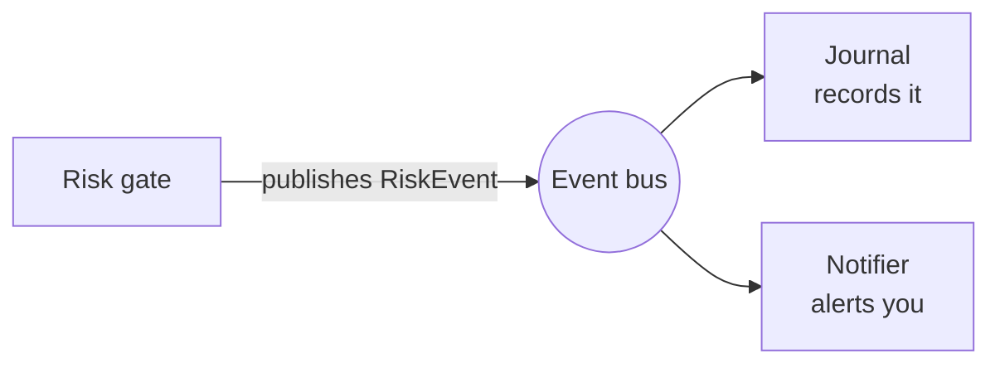

# Event-driven design

## The problem

The obvious way to build a trading pipeline is a chain of function calls:

```python
bars = fetch_bars()
signals = strategy.run(bars)
targets = build_portfolio(signals)
orders = apply_risk(targets)
broker.send(orders)
```

This works until you want more. To record every decision, you add logging to every function. To send a Discord alert when risk blocks something, the risk function must know about Discord. To run on minute bars, the top-level script must be rewritten. Each addition means editing code that already worked.

## The idea

Components do not call each other. Each one **publishes events**, which are small immutable records of something that happened, and **subscribes** to the events it cares about. A piece in the middle, the **event bus**, delivers them.



The risk gate does not know the journal or the notifier exist. To add a dashboard later, you add one more subscriber and touch nothing else.

If you come from front-end work, you already know this pattern. A button emits `click` without knowing who listens. A Redux store receives actions that describe what happened, and reducers and middleware respond. An event bus is the same idea on the back end.

Two habits make it work:

- **An event is a fact, not a command.** `FillEvent` says an order was filled. It does not tell anyone what to do about it. Facts can have any number of listeners; commands assume exactly one.
- **Events are immutable.** Once published, an event never changes, so every subscriber sees the same thing and the log can be trusted.

## Where it is in Tyche

- Event types and the bus: `tyche.core.events`. The full list is the [event catalog](../architecture/event-catalog.md).

  ```python
  bus = EventBus(clock.now)
  bus.subscribe(FillEvent, account.on_fill, name="account")
  bus.subscribe(Event, journal.record, name="journal")  # every event

  bus.publish(bar_event, source="feed")  # only queues it
  bus.drain()  # handle it, and everything it causes, before the next input
  ```

- Each pipeline stage in `tyche.core.pipeline` subscribes to one kind of event and publishes another.
- The journal subscribes to everything, which is how "record every decision with its reasons" comes for free.

Tyche's bus is deliberately simple: one thread, one queue, one event at a time ([ADR-0003](../adr/0003-synchronous-event-bus.md)). "Event-driven" does not have to mean asynchronous. Keeping it synchronous means the same inputs always produce the same sequence of events, which is what makes a backtest repeatable.

Each event also records which event caused it, and no component has to do anything for that to happen: the bus knows which event is being handled when a new one is published, and writes the link into the new event's envelope. Following those links backwards from an order gives you the approved target, the risk adjustments, the signals and the bars behind it.

## What it costs

- **The flow is harder to see.** With function calls you can read top to bottom. With events you need to know who subscribes to what. Tyche handles this by registering all subscriptions in one place (the engine) and by keeping the catalog up to date.
- **Ordering needs rules.** If two components react to the same event, which goes first? Tyche's answer is registration order plus "finish everything caused by one input before taking the next". The second half matters more than it looks: a bar can fill an order, and the decision that follows must see that fill. A test in `tests/core/events/test_bus.py` shows the decision going wrong when the rule is skipped.
- **A loop is easy to write.** Handler A publishes an event that handler B answers with one that A reacts to, forever. The bus stops and halts after a set number of events in one drain.
- **It is more code** than five function calls. It pays for itself only because Tyche needs the journal, the notifier, three run modes and, later, intraday data.
