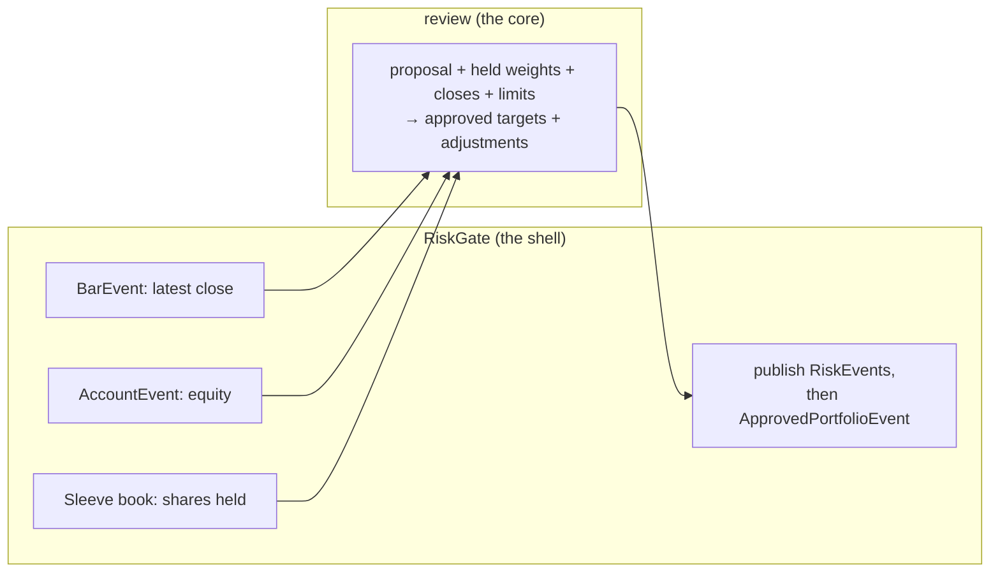

# Functional core, imperative shell

## The problem

The risk gate is the most important code in Tyche: it decides how much may be bought. It must be easy to test exhaustively, including cases nobody thought to write down. But as a pipeline stage it is wired into the event bus: it listens for closing prices and account snapshots, remembers the latest of each, reads the sleeve book, and publishes events. Testing every rule through all of that means building a bus, publishing bars and an account, then searching the published events for the answer. Each test is long, and a property-based test (thousands of random cases) becomes slow and hard to write.

The tension is between code that **talks to the world** (events, state, other components) and code that **decides** (the rules). Mixed together, the deciding part is only reachable through the talking part.

## The idea

Split the component in two:

- a **functional core**: a pure function that takes plain values and returns plain values. No bus, no clock, no state kept between calls. Given the same inputs it always gives the same answer, so it can be tested with a single function call;
- an **imperative shell**: a thin wrapper that gathers the inputs from the world, calls the core, and sends the result back out. It holds the state and the wiring, and almost no logic.

The shell is so simple that a handful of tests cover it: does it pass the right inputs, publish in the right order, halt when a snapshot is missing. Everything that can be wrong in an interesting way lives in the core, where it is cheap to test thoroughly.

## Where it is in Tyche

`tyche.core.risk.review` is the core: it takes a `TargetPortfolioEvent`, what each sleeve holds as a weight of equity, the closes and the `RiskLimits`, and returns a `Review` (the approved targets and every `RiskAdjustment`). `RiskGate` is the shell: it subscribes to bars, account snapshots and proposals, turns the sleeve book's shares into weights, calls `review`, and publishes ([ADR-0033](../adr/0033-risk-gate-position-rules.md)).

The split is what makes the gate's [property-based tests](property-based-testing.md) practical: `tests/core/risk/test_gate_properties.py` draws random proposals, holdings and limits and checks every limit on what `review` approves, with no bus in sight. To check that the properties have teeth, each rule was removed in turn and a property failed every time.

Other places follow the same shape on a smaller scale: `split_pro_rata` and `fit_to_cash` are the pure allocation rules inside execution, and `measure_backtest` turns a finished run into metrics without touching the run.

## What it costs

- **Two names for one component.** A reader has to know that `RiskGate` does nothing interesting and the rules are in `review`. The module docstring says so.
- **Inputs must be made explicit.** The core cannot read the sleeve book or the account itself, so the shell must convert them into plain values first (shares into weights of equity). That conversion is shell logic and needs its own test.
- **It is not always worth it.** A stage whose logic is a few lines gains little from the split. It pays off where the rules are many and the cost of a mistake is high.
