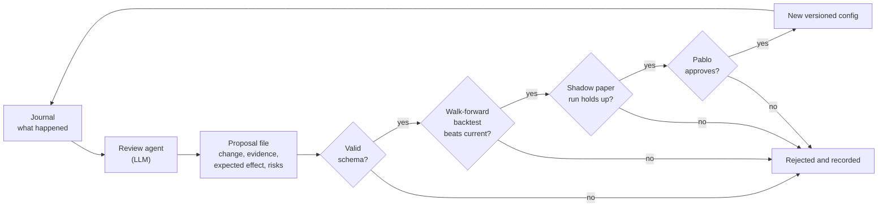

# The gated agent loop

## The problem

"A trading bot that improves itself with AI" can be built in a way that is exciting and dangerous: let a language model look at the market and decide trades, or let it rewrite the strategy while it runs. Three things go wrong.

- **You cannot test it.** The same question can get a different answer tomorrow, so a backtest of an LLM-driven strategy does not predict what it will do.
- **You cannot audit it.** When it loses money, there is no rule to point at.
- **It can be steered.** A model that reads news or web pages can be influenced by whoever writes them.

But LLMs are good at something useful here: reading a pile of results and noticing what a busy person would miss.

## The idea

Give the LLM a narrow job, **proposing**, and put gates between a proposal and any effect.

The LLM appears once, on the left. Everything to the right of the proposal is ordinary code and a human decision. The system improves through this loop, but it never modifies itself while trading.

A useful comparison is a pull request. A contributor (the agent) proposes a change with a description. CI (the automated gate) checks it. A maintainer (you) approves it. Nobody lets contributors push to production, however good they are.

### What "agent" means in Tyche

There are two common designs:

1. **The model drives.** The LLM is given tools and a goal and decides what to do next in a loop. Powerful and open-ended. Claude Code works this way.
2. **The code drives.** A program runs fixed steps, and one of those steps is "ask the LLM this question and get JSON back".

Tyche uses the second for its agents ([ADR-0007](../adr/0007-python-driven-agents.md)). It is less flexible and much easier to test, reproduce and move to a different model, because the model is just a function behind an interface (`LLMProvider`). You are using the first design right now, to build Tyche; the second is what Tyche runs.

### Structured output is the contract

The agent must reply with JSON that matches a schema. This matters more than it seems. Free text has to be interpreted; a schema-valid proposal can be processed by code with no interpretation. A reply that does not match is rejected like any other bad input.

## Where it is in Tyche

- Agent workflows: `tyche.core.agents`.
- The gate, approvals and strategy lifecycle (no LLM): `tyche.core.improvement`.
- The model behind an interface: the `LLMProvider` port and `tyche.adapters.llm`.
- The isolation is checked in CI: trading-path code cannot import agent code.
- Full design: [agent architecture](../architecture/agent-architecture.md).

## What it costs

- **It is slow by design.** A good idea takes weeks to reach live trading. That is the point.
- **The gate can be fooled by repetition.** Propose enough variations and one will pass the backtest by luck. This is overfitting, and the loop makes it easy to do without noticing. Tyche counts every candidate tried, keeps a slice of history the agents never see, and makes each proposal state its expected effect in advance.
- **An agent is only as good as what it is shown.** With one call and no tools, the agent cannot go looking for more. Designing what goes into its input bundle is most of the work.
