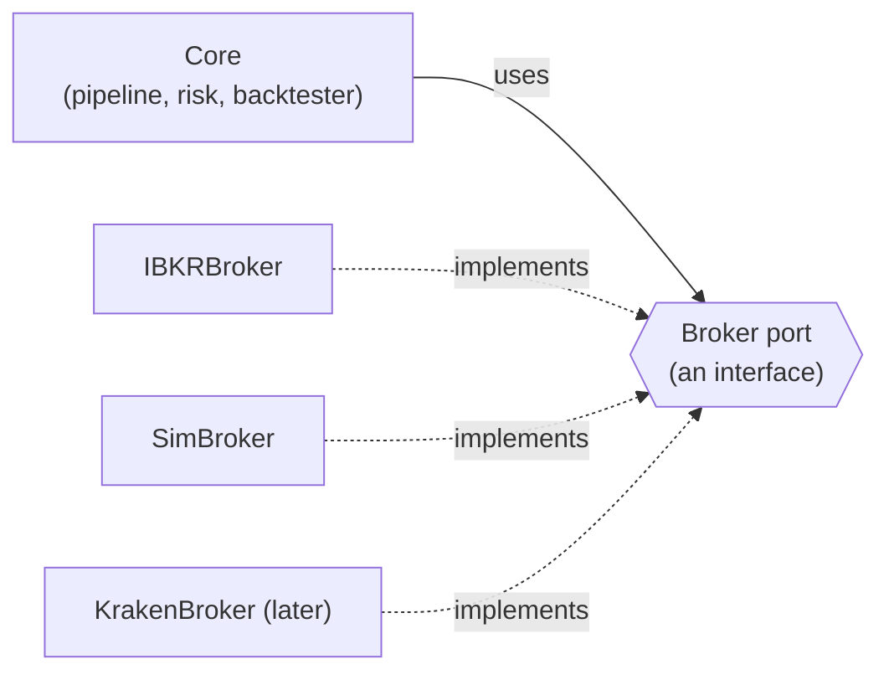

# Hexagonal architecture (ports and adapters)

## The problem

Trading logic and vendor code tend to grow together. An order-sizing function ends up calling the IBKR library directly. A strategy reads prices straight from yfinance. Then:

- You cannot test the sizing logic without a broker connection.
- You cannot backtest, because the code insists on talking to a real broker.
- Adding Kraken means editing the sizing logic, which has nothing to do with Kraken.

## The idea

Split the code in two.

- **The core** holds the logic that makes Tyche what it is: the pipeline, the risk rules, the backtester. It is pure. It does not touch the network, the disk or the system clock.
- When the core needs something from outside, it declares an interface saying what it needs. That interface is a **port**. For example: "I need something that can submit an order and tell me about fills."
- **An adapter** is a piece of code outside the core that fulfils a port using a real technology. `IBKRBroker` fulfils the `Broker` port with `ib_async`. `SimBroker` fulfils the same port with a simulation.

The important detail is the direction of the arrows. The core does not depend on IBKR. IBKR's adapter depends on the core's interface. This is called **dependency inversion**: the detail depends on the policy, not the other way round.

A front-end comparison: a component that takes a `fetchUser` function as a prop, instead of importing `axios` itself. The component defines what it needs; the caller decides how to provide it; a test passes a fake.

The name "hexagonal" is only how the original diagram was drawn, with the core as a hexagon and adapters around it. "Ports and adapters" describes it better.

## Where it is in Tyche

- Ports: `tyche.core.ports` (`Clock`, `Calendar`, `DataProvider`, `Broker`, `Notifier`, `LLMProvider`, `JournalStore`).
- Adapters: `tyche.adapters`, one folder per port.
- The one place that knows both sides and connects them: `tyche.runtime`, called the **composition root**.
- The rule is enforced, not just written down. `make imports` fails if the core imports an adapter or a vendor library. See the [repo map](../developer-guide/repo-map.md#dependency-rules).

One Tyche-specific choice: the dividing line is *purity*. `SimBroker` implements a port, but it is pure code with no outside dependency, so it lives in the core (`tyche.core.sim`). Adapters are only the code that reaches outside.

## What it costs

- **More files and one more hop.** To follow an order to the broker you go through an interface. For a script that will only ever use one broker, that is waste.
- **Interfaces can be wrong.** A port designed around one vendor may not fit the next. Tyche's `Broker` port gets its real test in Phase 6, when Kraken has to fit it.
- **Discipline.** The shortcut of importing the vendor directly is always tempting. That is why CI checks it.

It pays off here because Tyche needs three brokers (simulated, IBKR, Kraken), swappable data sources, and a core that can be tested in milliseconds without a network.
