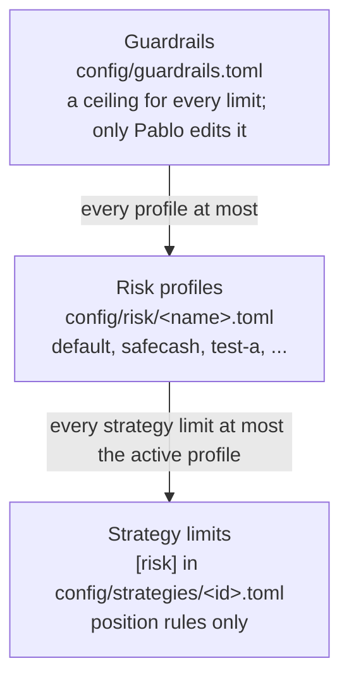

# Layered limits

## The problem

A trading system needs limits: how much one trade may lose, how many positions it may hold, when to stop after a bad day. Those limits must change: a cautious setting for a new strategy, a looser one to see what a backtest does with more room. But a system whose limits anyone can loosen in one place has no limits at all. A typo, a hurried experiment, or an agent's proposal applied without reading it is enough.

The tension is between **flexibility** (many named settings, chosen per run) and **safety** (some lines nobody crosses by accident).

## The idea

Put the limits in layers, where each layer may only be **stricter** than the one above it, and check the whole stack before anything runs.

- The **guardrails** change rarely and deliberately. They hold a ceiling for *every* limit a profile can set, so no profile can switch a protection off: a drawdown kill of 100% is not "a loose profile", it is no drawdown kill.
- **Profiles** are where flexibility lives. Make as many as you like and choose one per run. Each one is checked against the guardrails when Tyche starts, whether it is used or not.
- **Strategy limits** tighten a single strategy further, such as a smaller position for a strategy you trust less. They can never loosen anything.

Because every layer is checked at startup, a breach is a refusal to start with a message naming the file, the key, its value and the limit it broke. It never becomes a surprise in the middle of a run.

## Why "stricter only", and why refuse rather than clamp

Two alternatives look friendlier and are worse:

- **Let a lower layer override in both directions.** Then the top layer is a default, not a limit.
- **Silently clamp a value that is too loose to the limit above.** The run is safe, but the file now says something that is not true. Someone reading `max_position_size = "0.50"` in a strategy file would believe that strategy can hold half the account. A refusal makes the file and the behaviour agree.

The same reasoning is behind [config at the boundary](config-at-the-boundary.md): check everything once, as it enters, and make the result a type that cannot be wrong. Here the "type" is the checked stack of limits.

## Defence in depth

Layered limits are one case of a general security idea, **defence in depth**: several independent barriers, each able to stop a mistake the others let through. In Tyche:

| Barrier | Stops |
|---|---|
| The guardrails file, edited only by Pablo | A profile or an agent's proposal that loosens a protection |
| Startup checks of every layer | A breach becoming behaviour |
| The risk gate (from Phase 2, PR 2) | A proposed portfolio that breaks the active limits |
| An order-level check (PR 3) | An order that breaks a guardrail after sizing |
| Never-do rule 3 in `CLAUDE.md` | The AI pair editing guardrails or a live profile |

No single barrier is trusted to be perfect.

## Where it is in the code

- `tyche.core.risk.limits`: `Guardrails`, `RiskProfile` and `StrategyRiskLimits`, each checking its own values, and `breaches()` comparing a layer with the one above. Pure code, no files.
- `tyche.config.loader`: reads the three files, converts them, runs the checks and names the file in every message.
- [ADR-0032](../adr/0032-risk-limits-in-three-layers.md): the decisions behind the schema.
