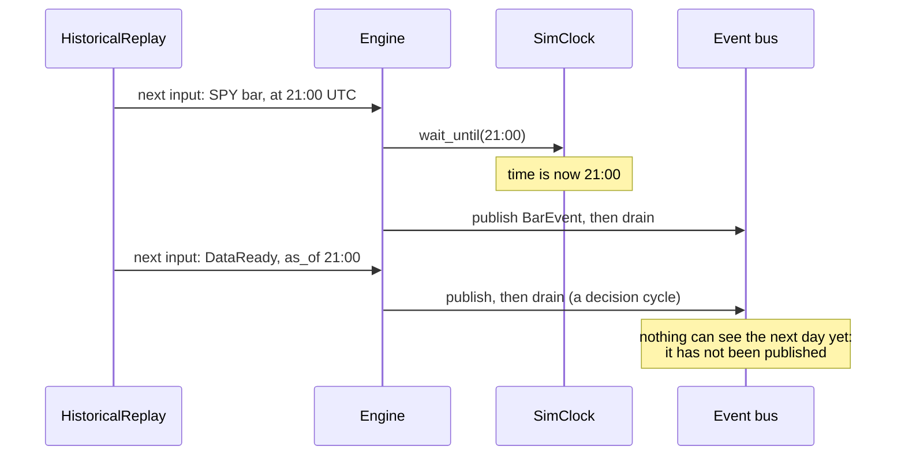

# Lookahead bias

## The problem

A backtest replays history and asks: "what would my strategy have done?". It has the whole history in memory at once, including the future of every day it is pretending to live through. Lookahead bias is when any piece of that future leaks into a decision.

It almost never looks like cheating. Typical leaks:

- **Wrong timestamp.** A daily bar stamped at midnight looks as if it was known before the market opened. A strategy deciding "at the open" then trades on a close that has not happened yet.
- **Same-bar fills.** A signal computed from today's close is filled at today's close. In reality the close is only known once trading has stopped.
- **Whole-series maths.** A moving average or a normalisation computed over the full table, then sliced per day, quietly includes the days after.
- **Revised data.** Today's version of a price series, adjusted for events that had not happened yet on the day being simulated.

The result is the most dangerous kind of bug: the backtest looks better than reality, and nothing fails.

## The idea

Make "what is known now?" a question the code can answer, and make the answer impossible to get wrong.

1. **Every fact carries the moment it became known.** A bar's timestamp is its close, in UTC, not the start of its day ([ADR-0012](../adr/0012-money-and-time-types.md)).
2. **There is one clock, and only the engine moves it.** Nothing in the core reads the system time. In a backtest the clock is a `SimClock` that stands still until the engine moves it ([time as a port](time-as-a-port.md)).
3. **The feed releases facts only when the clock reaches them.** The replay schedules each bar at its own close. The engine moves the clock to that moment, publishes the bar, and lets everything it causes finish before taking the next input.
4. **Decisions are made on what has arrived, at a known moment.** A decision cycle starts with `DataReadyEvent`, whose `as_of` is the close just delivered. Orders decided then fill at the next session's open at the earliest (brief, section 6; built in PR 10).

Because the strategy only ever receives events, and events only exist once the clock has reached them, there is no table of future prices for it to peek at. The bias is prevented by construction, not by care.

## Where it is in Tyche

- Bar timestamps at the close: `Bar` in `tyche.core.domain.bar`, set by each data source from the calendar.
- The clock: `SimClock` in `tyche.core.sim.clock`, and the `PacedClock` port the engine waits on.
- The replay: `HistoricalReplay` in `tyche.core.sim.replay`.
- The loop: `Engine` in `tyche.core.engine`.
- The proof: `tests/integration/test_data_to_engine.py` subscribes a guard to every event and fails the run if any bar is seen before the clock reaches its close.

## What it still does not cover

- **Fills.** The rule "decide at close *t*, fill at open *t+1*" belongs to the simulated broker (PR 10).
- **Strategy maths.** A strategy that receives its history as a table could still compute over too much of it. PR 12 decides how strategies see history, so that a strategy can only ever be handed bars up to the current moment.
- **Revised data.** The cache records when each bar was fetched, and split-adjusted prices do not change with dividends ([ADR-0019](../adr/0019-split-adjusted-prices-and-cash-dividends.md)). But a split adjusts every earlier price, so a backtest over a period before a split sees prices on today's share basis. That changes price levels, not returns, so it does not leak information about the future.
- **Survivorship.** History only includes instruments that still exist today. That is a bias of the data, not of the timing, and every report will state it.
