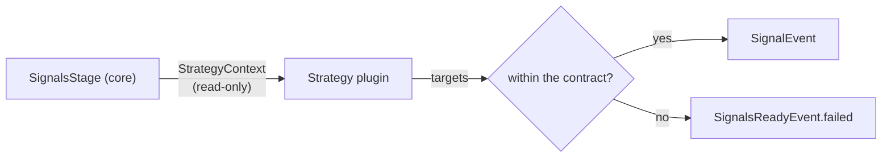

# Plugins: adding behaviour without changing the core

## The problem

The brief asks that adding a strategy means "one file plus config, no core changes". A strategy is also the code most likely to change, the code an agent may one day draft, and the code most likely to have a bug. It sits next to a system that handles money.

So the core must let new strategies in without knowing their names, and must not trust what they do.

## The idea

**The core defines a small contract, hands the plugin only what the contract allows, and checks everything that comes back.**

- **A protocol, not a base class.** `Strategy` (`tyche.core.pipeline.signals`) is a `typing.Protocol`: anything with a `strategy_id`, `version`, `timeframe`, `lookback` and a `decide` method is a strategy. Nothing to inherit, so the plugin depends on the contract and never the other way round. mypy checks the shape at compile time.
- **Hand in, don't let reach out.** The plugin gets a `StrategyContext`: the ranking, a read-only window of history, its own positions. It gets no bus, no clock, no data provider. What it cannot reach it cannot misuse, and it cannot see the future because the context holds only what was already published ([lookahead bias](lookahead-bias.md)).
- **Walls checked by CI.** An import-linter contract forbids `tyche.strategies` from importing risk, execution, the engine, the simulator or any port. A strategy that tries to place its own order fails the build, not a code review.
- **Check what comes back.** The stage refuses targets for instruments the strategy was not offered, weights that add up to more than its budget, a stop above the price. A failing plugin is recorded and skipped for that cycle; the rest of the run goes on. A bug in the stage itself still halts the run, because that is the core's fault, not a plugin's.
- **No state.** A plugin that remembers nothing between calls behaves the same after a restart, so paper and live match the backtest. Its memory is the context.

## Where it is in Tyche

| Piece | Where |
|---|---|
| The contract | `Strategy`, `StrategyContext`, `HistoryView` in `tyche.core.pipeline.signals` |
| The checks | `SignalsStage` in the same package |
| The walls | The "Strategies cannot reach..." contract in `pyproject.toml` |
| A plugin | `BuyAndHold` in `tyche.strategies` |
| The decision | [ADR-0021](../adr/0021-strategies-see-a-window-handed-in.md) |
| How to write one | [How to add a strategy](../developer-guide/how-to-add-a-strategy.md) |

`Screen` in the screening stage follows the same pattern on a smaller scale, and brokers, notifiers and data sources are plugged in the same way at the edges, through ports ([hexagonal architecture](hexagonal-architecture.md)).

## The trade-off

A plugin cannot do anything the contract does not allow. A strategy that wants two timeframes, or a signal from a source the core does not publish, needs the contract to grow first. That is deliberate: every new power is a decision recorded in an ADR, not a line in a plugin.
