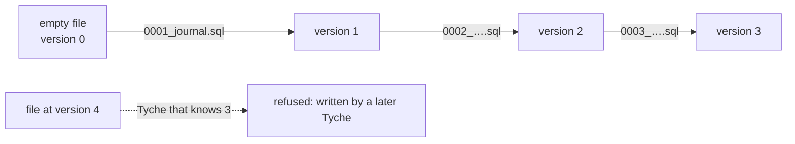

# Schema migrations and an append-only log

## The problem

A database outlives the code that created it. Tyche's state file will be written by version 0.2, then read and extended by 0.3, 0.4 and beyond, on your machine and in a container. Every version must know what shape the file is in, and bring it up to the shape it expects, without losing a row.

The journal adds a harder twist. Its rows are never changed ([ADR-0009](../adr/0009-storage-sqlite-parquet.md)): that is what makes it trustworthy as a record of what happened. So an event written today must still be readable after the event's class has changed, by code that did not exist when it was written.

## The idea

Two ideas, one for each half.

**Numbered migrations.** Every change to the tables is a small script with a number, kept forever. The database remembers the last number it ran. Opening it runs every newer script in order, each in its own transaction, so the file is always at exactly one known version. A script, once shipped, is never edited: some database somewhere has already run it.

**A self-describing, versioned log.** Each row says what it is (its type) and how it was written (a format number). Code that reads it rebuilds the object through its constructor, so its own checks run again. Changes that old rows can survive (a new field with a default) need nothing. Changes they cannot survive get a new format number and a reader for the old one, instead of a migration that rewrites history.

## Where it is in Tyche

- `tyche.adapters.storage.sqlite`: `open_database` and the migration runner. The scripts are `src/tyche/adapters/storage/migrations/NNNN_*.sql`; the version is SQLite's `PRAGMA user_version`, a number in the file's header that SQLite leaves to the application ([ADR-0037](../adr/0037-state-database-migrations-and-stored-journal.md)).
- `tyche.adapters.storage.codec`: events as tagged JSON. `{"$type": "Money", "fields": {...}}`, `{"$decimal": "10.50"}`, and so on, for a closed list of Tyche's own types.
- `tests/adapters/storage/test_sqlite.py` shows a failed migration leaving the file exactly as it was, and a newer file being refused.
- `tests/integration/test_journal_round_trip.py` stores two real backtests and reads every event back identical.

## What it costs

- **Discipline instead of tooling.** Nothing stops someone editing a merged script except the rule and the review. Tools such as Alembic add autogeneration and downgrades; for one writer and a few tables, a folder of SQL files is easier to read than a framework.
- **No undo.** Migrations only go forward. Reversing a change is another migration, which is also how it would have to work on a database that holds real orders.
- **Old formats are forever.** Each incompatible change to a stored event adds a reader that can never be deleted, as long as old rows exist. That is a reason to design events carefully, and to prefer adding fields over changing them.
- **A closed list of types.** The codec stores only types Tyche exports, so adding an event means exporting it. That is the price of never letting stored text decide what code runs.
