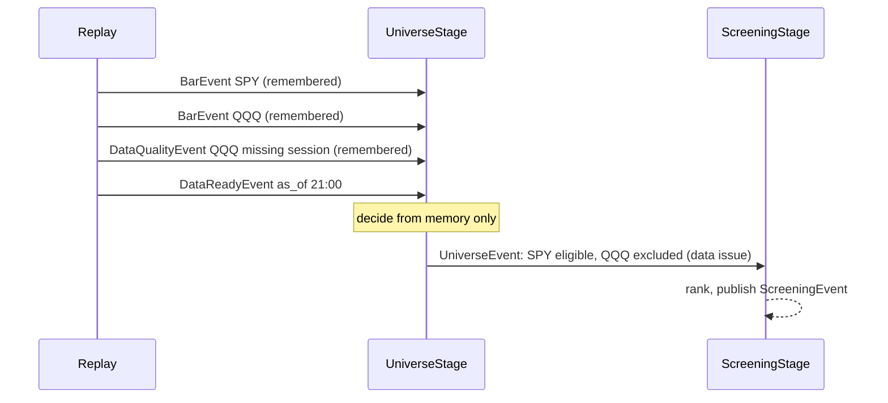

# State built from events

## The problem

Some pipeline stages need a memory. The universe stage, for example, cannot judge liquidity from one bar: it needs the average dollar volume over the last twenty. It also has to remember that a data problem was reported three days ago.

The obvious way to get that memory is to ask for it: "data provider, give me SPY's last twenty bars". In a backtest the data provider holds the whole history, future included, so one wrong date in that request and the stage is reading tomorrow's prices ([lookahead bias](lookahead-bias.md)). It also means the stage behaves differently in a backtest, where the history is a file, and in paper trading, where it arrives day by day.

## The idea

**A stage remembers only what it has been told.** It subscribes to the events that carry what it needs and keeps its own small, bounded copy. When a decision cycle starts, it decides from that copy and nothing else.

- It cannot see the future, because the future has not been published yet. The replay releases each bar at its close and the engine finishes every decision before the next bar exists.
- It behaves the same in every mode. In a backtest the events come from the replay; in paper and live they come from the live feed. The stage cannot tell the difference ([parity](backtest-paper-live-parity.md)).
- It can be tested without a data provider: publish a few events, read what it publishes back.

The memory is kept bounded on purpose. A stage that needs twenty bars keeps twenty, in a `deque(maxlen=20)`, so memory does not grow with the length of a backtest.

## Where it is in Tyche

`UniverseStage` (`tyche.core.pipeline.universe`) subscribes to three events:

| Event | What it remembers |
|---|---|
| `BarEvent` | The last `liquidity_sessions` bars of each instrument |
| `DataQualityEvent` | For each instrument, the latest disqualifying issue and how many cycles it still counts |
| `DataReadyEvent` | Nothing. This is when it decides, and publishes one `UniverseEvent` |

`ScreeningStage` is the opposite case: it remembers nothing. Everything it needs, the measurements of each eligible instrument, travels inside the `UniverseEvent`. A stage that can work from its input event alone should, because a stage with no memory cannot be out of date.

`SimBroker` works the same way: it learns the account from fills and the prices from bars, never by asking.

## What it costs

- **Warm-up.** On the first day of a backtest the universe has seen no bars, so nothing is eligible for the first `liquidity_sessions` sessions. The backtest runner (PR 15) starts the replay early enough to cover the warm-up.
- **Copies.** Each stage that needs history keeps its own copy. That is cheap for a few instruments of daily data, and it keeps the stages independent. The signals stage (PR 12) keeps its own `BarWindows` the same way, keyed by instrument and timeframe ([ADR-0021](../adr/0021-strategies-see-a-window-handed-in.md)); the universe could move onto it later, but a second small copy is simpler than coupling two stages.
- **Memory is lost when the process stops.** In paper and live, a restart rebuilds the market memory by replaying recent history before the first decision. That is the same warm-up again, and it is why the warm-up has to be explicit: `UniverseStage.warm_up` and `SignalsStage.warm_up` fill it from cached history, and every mode uses that same path. Memory of what Tyche *did* (the account, the sleeves, working orders, the peak and the halt) cannot be rebuilt from the market; it is saved in a [checkpoint](checkpoints.md).
