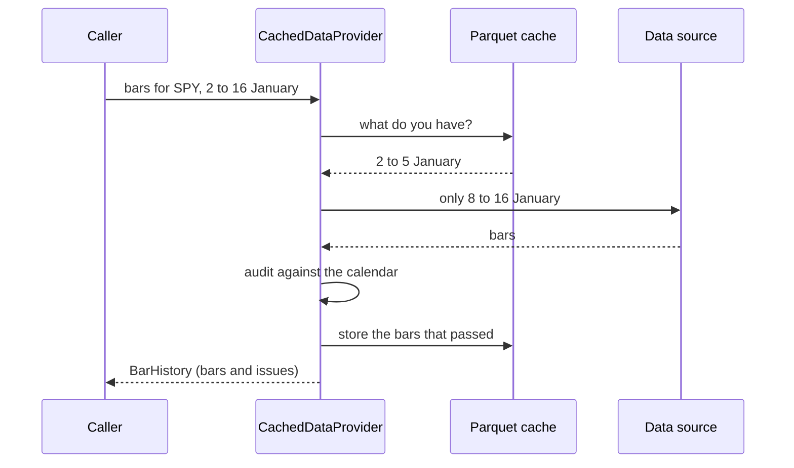

# Working with unreliable data

## The problem

Tyche's first data source is free, unofficial and known to be imperfect. Over twenty years of daily bars for one ETF you can expect a few of these:

- a day the market was open but there is no bar;
- a bar stamped at midnight, which looks as if it was known before the market opened;
- the same day twice, with different prices;
- a stock split the source forgot to apply, which looks like a 50% crash.

Each one is harmless if you notice it and dangerous if you don't. A strategy that sees a fake crash will happily sell.

Fetching is a second problem. Downloading twenty years of history every time a backtest runs is slow, and free sources limit how often you can ask.

## The idea

Two techniques, used together.

### 1. Audit against a source of truth

You can only find a missing day if you know which days should exist. The trading calendar is that source of truth: it knows every session, holiday and half day. So every answer is checked against it:

| Finding | What happens | Why |
|---|---|---|
| A session with no bar | Reported | Nothing is invented to fill it |
| A bar not at a session close | Dropped and reported | It cannot be right |
| Two different bars for one session | Both dropped and reported | There is no telling which is right |
| A move over 50% in one session | Kept and flagged | Possible, but more often a data error |

The result is a `BarHistory`: the bars that passed, plus a list of every issue. Whoever uses the data decides what an issue means for them. A backtest might note it in its report; the live system might refuse to trade that instrument today. Nothing is silently fixed ([ADR-0018](../adr/0018-audit-market-data.md)).

### 2. A read-through cache

A read-through cache sits in front of a slow source and has the same interface as the source. The caller asks for sessions; the cache answers from disk, asks the source only for what it does not have, stores the answer and returns it.

The interesting part is deciding what counts as "already have". A day the source has no bar for would otherwise be asked for again on every run, forever. So the cache also records **coverage**: which days it has already asked about. The rule:

- Days up to the last bar the source returned are covered, including any gap in the middle. Asking again would get the same answer.
- Days after the last bar returned are not covered. The source may simply not have published them yet, and they must be asked for again.
- An empty answer covers nothing, except for days that all fall before the earliest bar already cached. There the source has nothing because the instrument did not exist yet (GLD before November 2004), and that will not change. Those days are covered, and the audit keeps reporting them as missing sessions.

If you have used a data-fetching library on the front end such as React Query or SWR, this is the same idea as a cache key with a stale-time, except that here "fresh" is decided per trading session by the calendar.

## Where it is in Tyche

- The audit and `BarHistory`: `tyche.core.domain.bar_history`. Pure code, so it is the same for every source.
- The port the core uses: `DataProvider` in `tyche.core.ports.data`.
- The cache: `tyche.adapters.data.parquet_cache`. One Parquet file per instrument, with each bar's fetch time and the coverage in the file's metadata.
- The read-through provider: `tyche.adapters.data.cached_provider`.
- The clock decides which sessions should exist: a session that has not closed yet is not expected to have a bar.

### 3. Retry only what can change

Some failures are worth a second try and some are not. Tyche's Yahoo adapter sorts them:

| Failure | Retry? | Why |
|---|---|---|
| Rate limit (HTTP 429), server error (5xx), timeout, dropped connection | Yes, up to 3 tries, pausing 2 s then 4 s | The same request may work in a moment |
| Unknown symbol (HTTP 404) | No | It will fail the same way every time |
| No data for the range (a weekend, before a fund existed) | Not a failure | An empty answer; the audit reports the missing sessions |

The pause doubles each time (*exponential backoff*), so a struggling service gets more breathing room with each try instead of a burst of repeats.

## What it costs

- **A gap the source later fixes stays a gap in the cache**, because the day is already covered. Deleting the instrument's cache file forces a full refetch. A proper refresh command can come later.
- **Cached data ages.** Every bar records when it was fetched, and every `BarHistory` says the oldest and newest fetch time, so a report can state which snapshot of history it used.
- **Adjusted prices and caching do not mix well.** When a fund pays a dividend, a source that adjusts prices for dividends rewrites all of its past prices. Tyche avoids it by caching prices adjusted for splits only, which do not change when a dividend is paid, and keeping dividends as separate cash events ([ADR-0019](../adr/0019-split-adjusted-prices-and-cash-dividends.md)). A split still rewrites history, so a split the cache has not seen triggers a full refetch of that instrument. Every bar records its adjustment basis, and mixing bases in one series is an error.
