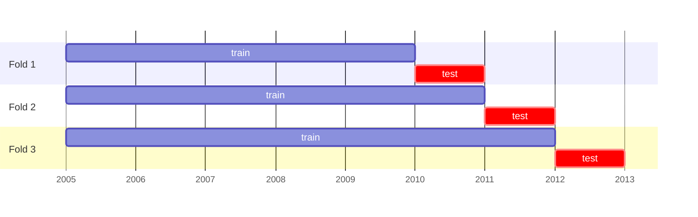

# Walk-forward testing and overfitting

## What problem does this solve

A backtest over all of history answers "how would these rules have done?", but only for rules nobody tuned on that history. As soon as a choice is made by looking at results, such as a lookback, a threshold or which strategy to keep, the same history can no longer judge that choice. The rules have been fitted to its noise, and they look better than they will do on days they have not seen. This is **overfitting**, and on a single backtest it is invisible.

## The idea

Never judge a choice on the data that made it. Split history in time:

- **Training window (in-sample).** Where the choice is made: parameters picked, a strategy kept.
- **Test window (out-of-sample).** The history right after it, which the choice has not seen. The choice is run there, unchanged, and that result is the one that counts.

One split gives one test result, which is a small sample and depends on where the cut fell. A **walk-forward** repeats the split along history. It trains on the past, tests on the next year, moves forward a year, and does it again. In this example the training windows grow (**anchored**):

**Rolling** windows keep a fixed length and drop the oldest year as they move. The test windows never overlap, so joined end to end they form one out-of-sample record: what the process of "choose on the past, trade the next year" would have earned.

Reading the result:

- **In-sample much better than out-of-sample, fold after fold**: the choice is fitting noise.
- **Both similar**: the choice carries over, at least across these years.
- **Both bad, or both swinging together**: the strategy depends on the period, which is worth knowing whether or not anything was fitted.

A walk-forward reduces overfitting; it does not remove it. Running many walk-forwards and keeping the best is overfitting again, one level up. That is why trials are counted and results deflated (PR 21), and why one slice of history, the holdout, is used by no experiment at all.

## Where is it in Tyche

- `src/tyche/core/backtest/walk_forward.py`: `plan_folds` cuts history into folds of calendar years from dates alone; `chain` joins the test windows' equity; `measure_walk_forward` measures them against the benchmark joined the same way. Pure, no I/O.
- `src/tyche/runtime/walk_forward.py`: runs each window as a full backtest through `run_and_record`, calls the **train step** between a fold's two runs, and writes `reports/walk_forward/<id>/`. The train step is `keep_configured` until parameter sweeps exist, so for now nothing is chosen and the in-sample/out-of-sample gap measures how the strategy varies between periods, not overfitting.
- `src/tyche/runtime/walk_forward_report.py`: the report, built from the record alone.
- `tyche walk-forward --from 2005-01-03`; [ADR-0029](../adr/0029-walk-forward-folds-and-a-train-step.md) records the choices.

## What does it cost

- **Time.** Every window is a backtest. With anchored folds, the training windows replay the early years again and again: 14 folds over 2005 to 2023 replay about 161 years of history.
- **Fewer years judged.** The first training window is never tested, so out-of-sample results start five years later than the history does.
- **Fresh starts.** Each test window starts in cash and buys its positions again, which costs a little that one continuous run would not pay.
- **Rules picked by people are not out-of-sample.** If the rules came from research on this same history, a walk-forward over it cannot fully test them. Only data nobody looked at can.
